# Check Performance Data: admin user guide

*Version 1.0, 29 September 2026. Describes the service as it worked on that date.*

## About this guide

This guide is for Department for Education (DfE) staff who use the admin area of the Check Performance Data service. That includes service owners, window administrators, content editors and the people who run data egress.

It covers every group on the Administration page, in the order the page shows them: Dashboard, CMS administration, System administration, Messages, Manage windows, Data egress, Audit log, View as an establishment and Danger zone. For each screen, it says what the screen is for, what you can see and what you can do.

This guide does not cover:

- what schools and colleges see and do in the service
- caseworking in Zendesk

The source of this guide is a Markdown file kept with the service's code, alongside the screenshots. If something in the guide is wrong or out of date, ask the development team to correct it.

## Contents

- 1. Getting access to the admin area
- 2. Finding your way around
- 3. Dashboard
- 4. CMS administration
    - Home page banners
- 5. System administration
- 6. Messages
- 7. Manage windows
- 8. Data egress
- 9. Audit log
- 10. View as an establishment
- 11. Danger zone
- Appendix A: Actions that cannot be undone
- Appendix B: Admin sections a role can be granted
- Appendix C: System settings reference
- Appendix D: Getting help

## 1. Getting access to the admin area

### Signing in

You sign in with your DfE Sign-In account. Choose your organisation when DfE Sign-In asks you to.

The top of every page is a band with the Department for Education logo. **Sign in** is on the right of the band. Once you are signed in, it changes to **Sign out**. The label does not show your name.

Under the band is a row of navigation links. Once you are signed in, an **Admin** link appears in this row. It appears for both admin roles. If you cannot see the link, you do not have an admin role. The link is also hidden while you are viewing the service as an establishment (chapter 10).

### Roles

Your access depends on the role DfE Sign-In gives you. There are 2 admin roles:

| Role | Who it is for | What it can see by default |
|---|---|---|
| `cypmd_admin` | Administrators | Every section. This role always has full access and you cannot reduce it. |
| `cypmd_content_access_user` | Content editors | Pages, Content blocks, Home page banners, Deleted pages, Seed sample CMS pages and Content staging import/export. |

You assign roles in DfE Sign-In, not in this service. An administrator can change which sections a role can see. Chapter 5 explains how, under Role settings.

Access is given to roles, not to named people. The service has no list of admin users.

### If you cannot see a page

If you type the address of an admin page that your role has not been given, the service shows the *Page not found* screen. It does not tell you that you are not allowed in. This is deliberate: it keeps the admin area hidden from people who should not use it.

If you think you should have access to a page, ask an administrator to give your role that section. Chapter 5 explains how.

*View as an establishment* works differently. It is not a section that can be given to a role. Only the `cypmd_admin` role, signed in through DfE Sign-In, can use it. The service refuses anyone else, and the browser address changes to `/Account/AccessDenied` before the *Page not found* screen appears. Chapter 10 explains it.

### Environments

The service runs in 4 environments. Each one uses a matching DfE Sign-In environment.

| Environment | Address | DfE Sign-In environment |
|---|---|---|
| Development | `https://check-performance-data-development.test.teacherservices.cloud/` | Test |
| QA | `https://check-performance-data-qa.test.teacherservices.cloud/` | Test |
| Preproduction | `https://preproduction.check-performance-data.education.gov.uk/` | Preproduction |
| Production | `https://check-performance-data.education.gov.uk/` | Production |

Some screens exist only outside production. This guide says so wherever it applies.

## 2. Finding your way around

### The Administration page

Select **Admin** in the header to open the *Administration* page. It shows one section for each group you have access to.

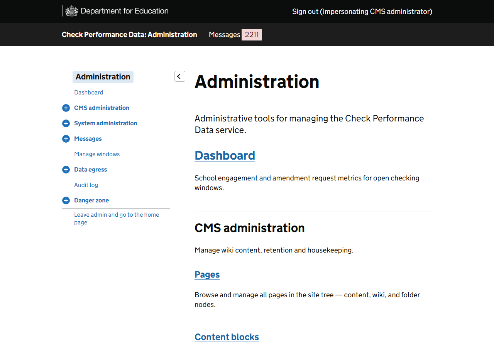
*The top of the Administration page. The side menu lists all nine entries. In the main area, each group has a heading, a description and links to its screens.*

There are nine entries. Dashboard, Manage windows, Audit log and View as an establishment are single links. The other five are groups that hold tiles. The entries are, in order:

- **Dashboard**: figures on school engagement and amendment requests.
- **CMS administration**: pages, content blocks, home page banners, deleted pages, content staging and search analytics.
- **System administration**: the rules engine, system settings, logs, site CSS and JavaScript, role settings and test data.
- **Messages**: search feedback and the dead-letter queue.
- **Manage windows**: creating and managing checking windows and their checking exercises. This is one link. It is not a group.
- **Data egress**: pulling approved decisions and sending them to the Learning Data Service (LDS).
- **Audit log**: a record of administrative activity.
- **View as an establishment**: seeing the service as one school or college sees it, in read-only mode. Only the `cypmd_admin` role, signed in through DfE Sign-In, sees this entry (chapter 10). Everyone else sees eight entries at most.
- **Danger zone**: actions that permanently delete data, and the blob storage browser.

### The side menu and the Messages badge

Every admin page has the same menu on the left. It shows the same groups as the Administration page. The page you are on is highlighted. Select the plus or minus button next to a group to open or close it. Select the arrow button above the menu to hide or show the whole menu.

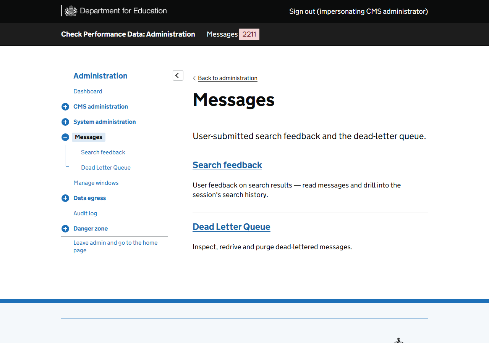
*The side menu, with the Messages group open. The count beside Messages in the header is the Messages badge.*

The Pages entry opens out into the live page tree of the site. Under the menu, **Leave admin and go to the home page** takes you back to the public service.

The **Messages** badge sits in the navigation row under the Department for Education band, on every admin page. Only the `cypmd_admin` role sees it. It counts 2 things added together: search feedback messages you have not read, and messages in the dead-letter queue. Select it to open the *Messages* page. The count is red while the dead-letter queue has any messages in it. Otherwise it is blue when the count is above 0, and grey when the count is 0.

### Conventions used in this guide

- You **select** links and buttons. The guide writes their names in bold, exactly as they appear on screen. Screen names and page titles are in italics.
- A **Warning** box marks an action that cannot be undone.
- Checking window and exercise dates and times are UK time. Other times are in UTC unless the screen says otherwise. UTC is the same as Greenwich Mean Time, and is one hour behind British Summer Time.

## 3. Dashboard

### School engagement and amendment request figures

Use the *Dashboard* to see how many schools have engaged with a checking window and how many amendment requests they have made.

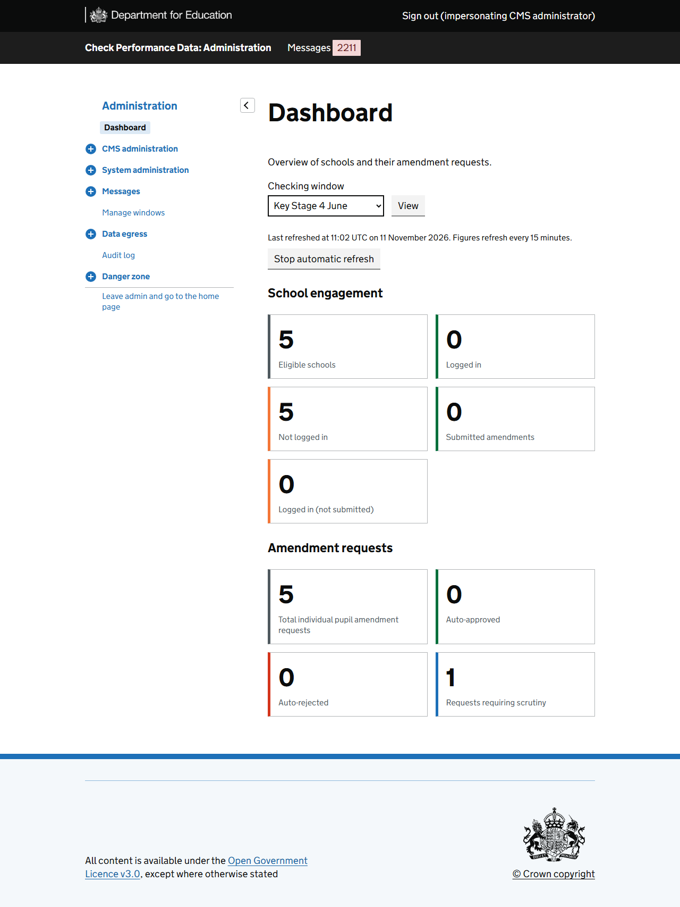
*The Dashboard for the Key Stage 4 June window.*

The dashboard lists open checking windows only. If no window is open, the page says *There are no open checking windows. Metrics are shown while a checking window is open.* and shows no figures. To see another window:

1. Choose a window from **Checking window**.
2. Select **View**.

The page shows when the figures were last refreshed. They refresh by themselves every 15 minutes unless the service's dashboard refresh setting has been changed. The page says how often it refreshes. To stop this, select **Stop automatic refresh**. The page then says *Automatic refresh is off. Reload the page to see newer figures.* Automatic refresh needs JavaScript. Without it, reload the page to see new figures.

The dashboard has 9 tiles:

| Group | Tile | What it counts |
|---|---|---|
| School engagement | Eligible schools | Schools that have a pupil data file in the window. |
| School engagement | Logged in | Eligible schools that signed in during the window's dates. |
| School engagement | Not logged in | Eligible schools that have not signed in. |
| School engagement | Submitted amendments | Eligible schools that have submitted at least one amendment request. |
| School engagement | Logged in (not submitted) | Schools that signed in but have not submitted a request. |
| Amendment requests | Total individual pupil amendment requests | Requests that schools have submitted. Drafts and withdrawn requests are not counted. |
| Amendment requests | Auto-approved | Submitted requests that the rules engine approved. |
| Amendment requests | Auto-rejected | Submitted requests that the rules engine rejected. |
| Amendment requests | Requests requiring scrutiny | Submitted requests that the rules engine sent to a caseworker. |

Some things to know when you read the figures:

- All 5 school engagement tiles count the same group of schools: the eligible schools.
- The Logged in figure counts sign-ins the service has recorded since it started recording them. Sign-ins from before then are not included.
- A submitted request that the rules engine has not yet decided counts in the total only. It does not count as approved, rejected or scrutiny.

## 4. CMS administration

The content management system (CMS) is where every public page of the service is written and published. This group holds the tools for managing it.

This guide covers what each screen does. For step-by-step help with writing and editing pages, use the in-app guide *How to use the CMS*, which is under Help in the public service.

### Pages

Use *Pages* to find, create, edit, move, copy and delete pages.

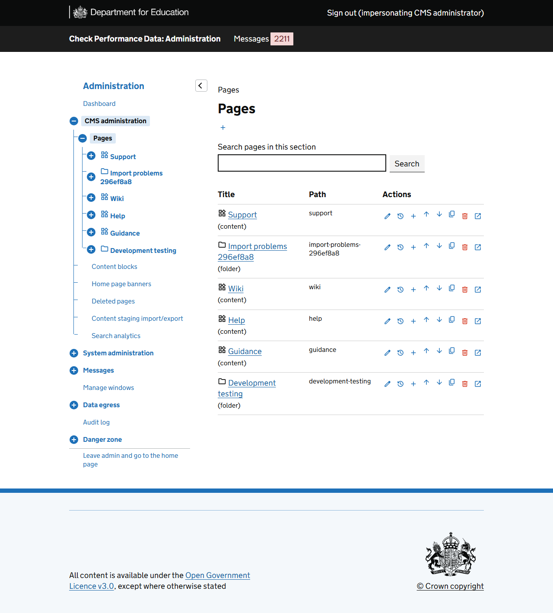
*The Pages screen, showing the top level of the site.*

The screen lists the pages at one level of the site tree. Each row shows the page title, its path and the type of page: content, wiki or folder. Select a page title to open the pages below it.

Each row has icon buttons. Their names are:

| Button | What it does |
|---|---|
| Edit | Opens the page editor in a new tab. |
| Versions | Opens the page editor on its version history. |
| Add child page | Creates a page below this one. |
| Move up and Move down | Changes the order of the page among the pages at the same level. |
| Copy | Makes a copy of the page. |
| Delete | Opens the delete confirmation for the page. |
| View | Opens the live page in a new tab. |

To search below the level you are looking at, enter words in **Search pages in this section** and select **Search**.

In the side menu, you can also press the right mouse button on a page to see the same actions: New child page, Edit, Versions, Move up, Move down, Copy page, Delete and View. You can move a page by dragging it in the side menu. Both need JavaScript.

#### Creating a page

1. To create a page at the top level, select the plus icon under the **Pages** heading. Its name is **Create a top-level page**. To create a page below another, select **Add child page** on its row.
2. Choose the **Page type**: Content, Wiki or Folder.
3. Enter the **URL segment**. Use lowercase letters, numbers and single hyphens. A hyphen cannot come first or last. For example, `my-page`. If you type capital letters, the service makes them lowercase when it creates the page.
4. Enter the **Title**.
5. Select **Create page**.

The service creates the page as a draft and opens it in the page editor. A new page is not live until you publish it.

#### Editing a page

Select **Edit** on a page to open the page editor. It has 3 tabs: Content, Properties and Versions. Above the tabs, a tag shows whether the page is published or a draft, and which version.

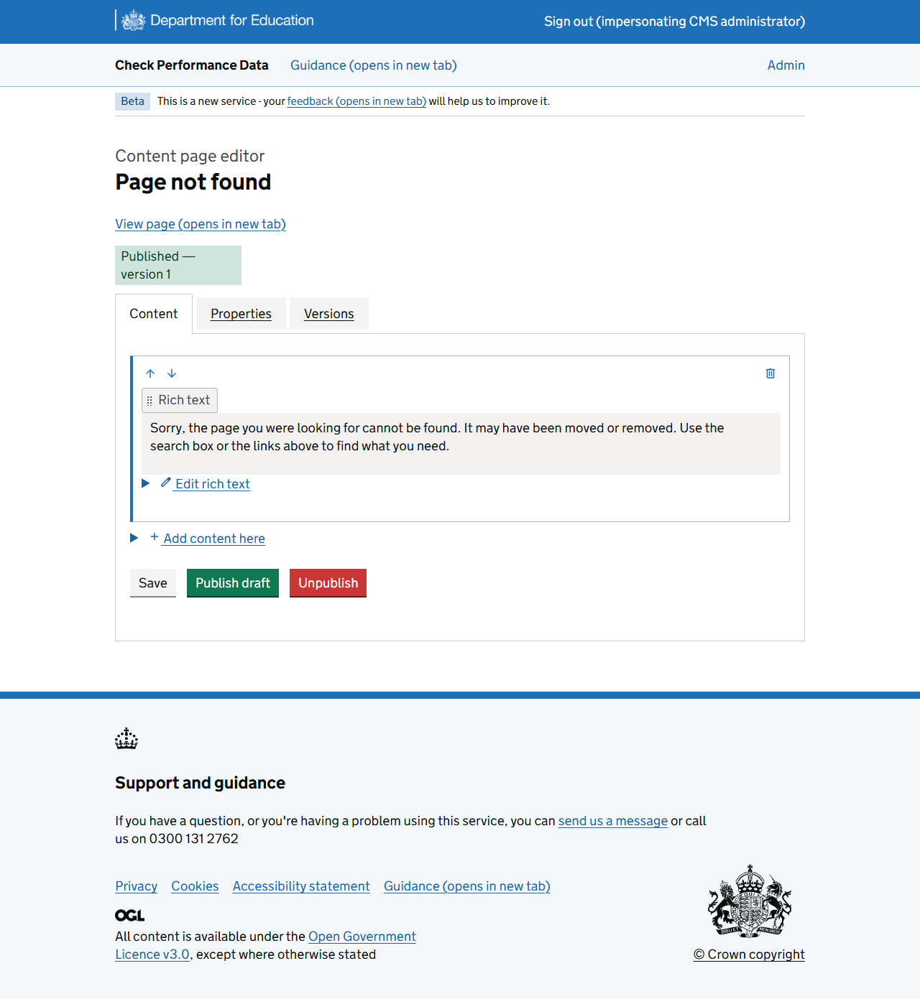
*The page editor. This page has one Rich text widget on the Content tab.*

On the **Content** tab you build the page from regions and widgets:

- A region sets the layout. The layouts are Single, Halves, Thirds, Quarters, OneThirdTwoThirds and TwoThirdsOneThird.
- A widget holds the content. The widgets are Card, Divider, Heading, Page navigation, Published callout, Rich text, Search, Search results and Summary list.

To add content, select **Add content here**. Choose a region layout and select **Add region**, or choose a widget and select **Add widget**. Widgets go inside a region. Each item has buttons to move it up or down and to delete it.

The Search and Search results widgets let you limit a search to chosen pages by ticking them in a list. On a long list, type in the **Filter pages** box to narrow it by page title or path, or tick **Show only selected pages** to check your choices. Ticked pages that the filter hides are still saved.

The buttons under the content are:

| Button | What it does |
|---|---|
| **Save** | Keeps the draft and refreshes the text that site search uses for the page. The service also keeps each change to the content as you make it. The live page does not change. |
| **Publish draft** | Makes the draft live. The tag above the tabs changes from *Draft* to *Published*. |
| **Unpublish** | Takes the live page offline. This button shows only while the page is published. |

On the **Properties** tab you can change the Title, Subtitle, Page name, URL segment, Show in menu, Appear in search and Search keywords. Select **Save details** to save them. The service confirms with a *Page details* message that says *Saved.* The URL segment follows the same rule as when you create a page. The service makes capital letters lowercase when you save. If the segment breaks the rule, the *Page details* message says *URL segment can only contain lowercase letters, numbers and single hyphens, for example my-page.* Changing the URL segment changes the address of the page and of every page below it. The service asks you to confirm with *Change page URL?*, and warns that existing links and bookmarks will stop working.

The **Versions** tab lists every saved version with its status, when it was changed and who changed it.

#### Publishing, scheduling and restoring versions

On the **Versions** tab, each version has **Publish from (UK time)** and **Publish to (UK time)** date and time fields, and these buttons. A hint above the table says the times are UK time: the time shown on UK clocks on that date, whether British Summer Time or Greenwich Mean Time applies. Enter the time as it shows on a UK clock. Do not convert it to UTC.

- **Save** saves the dates. A version with a Publish from date in the future goes live at that time. A version with a Publish to date stops being live at that time.
- **Publish** makes that version live now.
- **Unpublish** takes the live version offline.
- **View** previews the version.

The service refuses a time that does not exist when the clocks go forward. The message reads, for example, *Publish from must be a real UK time. On 29 March 2026 the clocks go forward from 1am to 2am, so 1:30am does not exist.* Choose a time before 1am or after 2am.

To go back to an earlier version of a page, select **Publish** on that version.

#### Deleting a page

1. Select **Delete** on the page's row.
2. Check the page name, then select **Delete page**.

You cannot delete a page that has pages below it. The screen tells you to remove or move the child pages first.

> **Warning** The delete screen says *This action cannot be undone*. In practice, the page moves to *Deleted pages*, where you can restore it. Do not rely on this: treat a delete as final.

### Content blocks

Use *Content blocks* to edit pieces of text that appear on several pages, such as the footer, without opening each page.

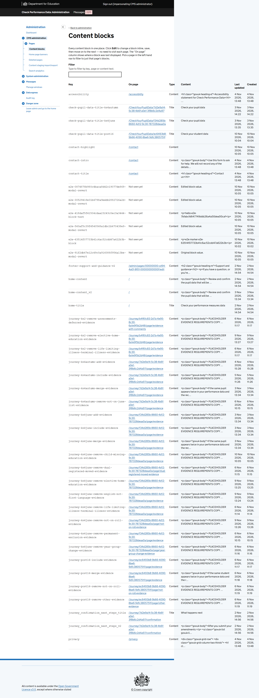
*The Content blocks screen. On a narrow window the table is wider than the screen, so scroll sideways to reach the Edit links.*

Each row shows the block key, the page it appears on, its type, its content, and when it was last updated and created. To find a block, enter words from its key, page or content in **Filter**. To see only the blocks on one page, choose that page in the side menu.

To edit a block:

1. Select **Edit** on the block's row. The edit form opens for that block.
2. Change the **Value**. You can also change **Appear in search**, which controls whether the block shows in help search results, and **Search keywords**.
3. Select **Save**, or select **Cancel** to leave the block as it was.

Each block keeps a version history. Select **Version history** in the block's edit form to see it. The *Content block versions* screen lists each version with its date, and previews the content when you select one. You can revert to an earlier version. The service asks you to confirm: *Are you sure you want to revert to version…?* It warns that this replaces the current published content, and adds the current version to the history.

### Home page banners

The start page (the page a school sees before signing in) can show one or more blue
"Important" notification banners: new rules, a known issue, an extension to a deadline.
Open **CMS administration > Home page banners**.

Each banner has a heading, rich text (links and lists are allowed), an on/off switch and
optional **Show from** and **Show until** dates and times. All times are UK time. A banner
shows only while it is on and within its dates; off always hides it. "Show from" includes the
minute you enter and "Show until" does not, so a banner due to end at 17:00 is gone at 17:00.

The list shows each banner's status: **Live** (on and within its dates), **Scheduled** (on,
not yet due), **Expired** (on, past its end) or **Off**. Banners appear on the start page, and at the top of the guidance front page (`/guidance`) but not on the pages below it, in
the order of the list; use **Move up** and **Move down** to change it.

Every save makes a new version. **Version history** shows them and lets you restore an
earlier one, which becomes the newest version. **Preview** shows a banner the way schools
will see it, whatever its status. **Delete** asks you to confirm and cannot be undone; to
hide a banner for a while, turn it off instead.

Banners are included in content staging export and import, with their versions. Editors
need the **Home page banners** section on Role settings; on an environment created before
this feature an administrator has to tick it.

### Deleted pages

Use *Deleted pages* to bring back a page that someone deleted.

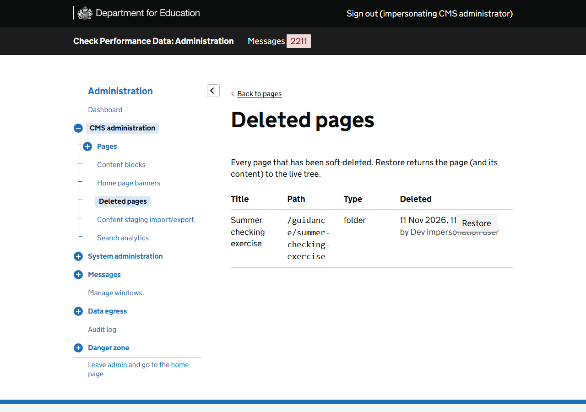
*The Deleted pages screen when no page has been deleted.*

Each deleted page is listed with its path, type, when it was deleted and who deleted it. Select **Restore** to put the page and its content back in the live tree. The service shows *Page restored.*

### Content staging import/export

Use *Content staging import/export* to move pages, content blocks and home page banners from one environment to another. For example, to copy content you have tested in QA to production.

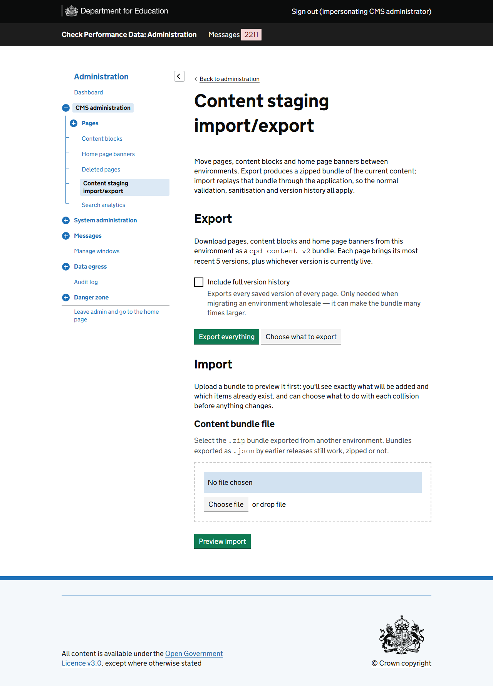
*The Content staging import/export screen.*

#### Exporting content

- Select **Export everything** to download every page, content block and home page banner as a zip file.
- Select **Choose what to export** to pick items. Tick the pages, content blocks and home page banners you want, then select **Export selected**. When you pick a page, its parent pages are always included, so the site structure stays intact.

Each page is exported with its 5 most recent versions and its live version. Tick **Include full version history** to export every saved version. Only do this when you are moving a whole environment, because it makes the file much larger.

#### Importing content

Importing has 2 steps. The first step changes nothing.

1. Under **Content bundle file**, choose the zip file you exported from another environment.
2. Select **Preview import**.
3. Read the *Review import* screen. It says how many items are new, how many are already in this environment and how many cannot be imported. Nothing changes until you confirm.
4. Choose what to do with the items:
    - **Default for new items**: **Include** adds them. **Skip** leaves them out.
    - **Default for items already in this environment**: **Skip** keeps what is there. **Overwrite** replaces it. **Fail** stops the import.
    - Each item also has its own choice, with **Use default** as the starting point. Use it to override the default for one item.
5. Select **Confirm import**. To leave without importing, select **Cancel**. When the import finishes, the service shows a summary such as *Import complete. Pages: 1 added, 11 updated, 0 skipped. Content blocks: 0 added, 0 updated, 0 skipped. Home page banners: 0 added, 0 updated, 0 skipped.*

Some items cannot be imported. The service lists them under *These items cannot be imported*, with the reason for each. This happens when an item's parent page is not in this environment or in the file. It also happens when an item breaks a rule, for example when two pages would end up at the same address once capital letters are made lowercase. The service skips these items and imports the rest. It does not create a blank parent for them.

If a page has capital letters in its URL segment, the import makes the segment lowercase and warns you. The warning appears in an *Important* box at the top of *Review import*, headed *Check this warning before you import.* (or *Check these 3 warnings before you import.*, with the number of warnings). Read it before you select **Confirm import**.

An import applies the normal checks and keeps version history, as if someone had typed the content in. Every import is recorded in the audit log.

> **Warning** In development environments only, and only if the *CMS:ShowDeleteAllButton* system setting is turned on, this screen also shows a **Clear all CMS content** button. The service asks you to confirm with *Clear all CMS content?* It deletes every page, content block and home page banner in the environment and cannot be undone. Only use it to reset a test environment. It is never available in production, QA or preproduction, whatever the setting says.

### Search analytics

Use *Search analytics* to see what people search for, whether they find results and where the content has gaps. The figures cover a time window you choose.

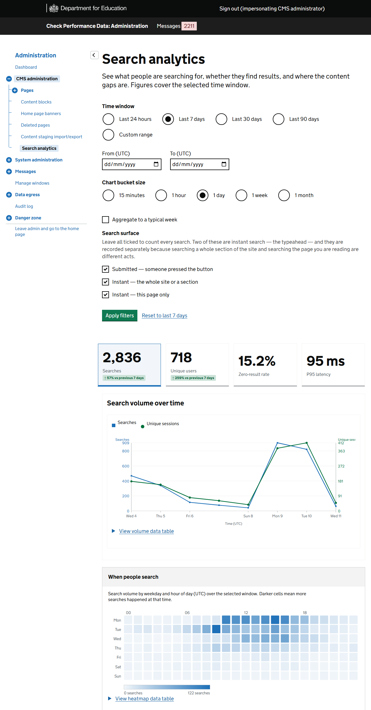
*The Search analytics screen.*

The filters at the top are:

- **Time window**: Last 24 hours, Last 7 days, Last 30 days, Last 90 days or Custom range. For a custom range, enter **From (UTC)** and **To (UTC)**.
- **Chart bucket size**: 15 minutes, 1 hour, 1 day, 1 week or 1 month.
- **Aggregate to a typical week**: tick this to combine all the weeks in the window into one typical week.
- **Search surface**: choose which kinds of search to count. *Submitted* is someone pressing the search button. *Instant, the whole site or a section* is the search-as-you-type suggestions. *Instant, this page only* is the search box that searches the page it sits on. The last 2 are recorded separately because they are different kinds of search.

Select **Apply filters** to update the screen. Select **Reset to last 7 days** to go back to the default.

Below the filters you will find:

- **4 summary figures**: Searches, Unique users, Zero-result rate and P95 latency. P95 latency is the time within which 95 out of 100 searches finished. Each figure shows how it compares with the previous period.
- **Search volume over time**: a chart of searches and unique sessions. Select **View volume data table** for the same figures as a table.
- **Unique sessions over time**, **Zero-result count over time** and **Latency percentiles over time**: one chart for each of the summary figures. Each has a link to the full figures.
- **Request timings**: a chart of the time each search took, shown under Latency percentiles over time.

With JavaScript on, each summary figure is a button that shows the chart for that figure. Without JavaScript, every chart shows.
- **When people search**: a chart of searches by weekday and hour. Darker cells mean more searches. Select a cell to see the sessions behind it.
- **Zero-result outcomes**: what happened after a search that found nothing. People either refined their search, sent feedback, or gave up without telling you.
- **Top queries**, **Top zero-result queries**, **Top pages** and **Top content blocks**.
- **Single-page search**: searches made with the search box on a single page.

Zero-result queries are the list of what to write next. If people keep searching for something and find nothing, that is a content gap.

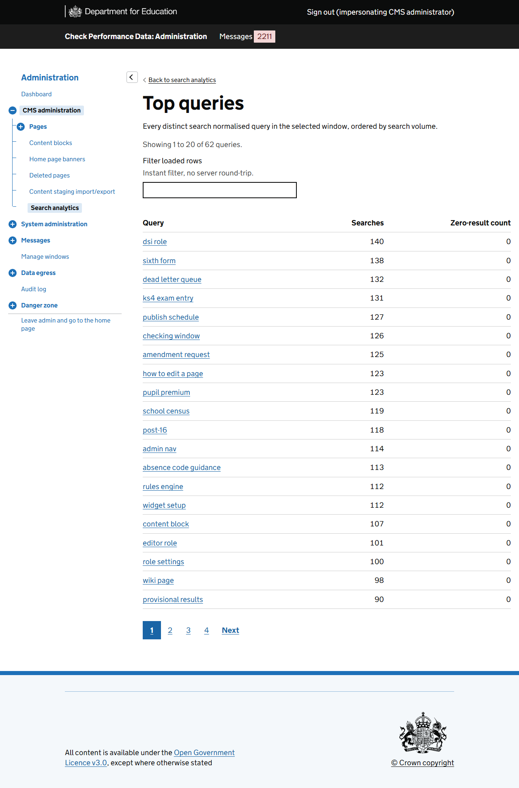
*The Top queries screen. Select **View all top queries** on the main screen to open it.*

Each list has a link to a full screen, such as **View all top queries** and **View all zero-result queries**. On the full screens you can filter the rows and move between pages. Select a query to run that search on the live site.

A session screen shows every search one visitor made, with the time, query, scope, number of results and how long each search took. The session screen also lets you delete that visitor's data.

> **Warning** Select **Delete this session's data** to permanently delete every search event and support message from that session. The service asks you to confirm with *Delete this session's data?* This cannot be undone. The deletion is recorded in the audit log.

## 5. System administration

This group holds the tools that keep the service running: the rules engine, system settings, logs, site CSS and JavaScript, and role settings.

### Rules Engine: what it does

When a school submits a change request, the rules engine decides what should happen to it. It gives each request one of 3 outcomes:

- **Auto-approved**: the request clearly meets the conditions to be accepted.
- **Auto-rejected**: the request clearly does not qualify.
- **Scrutiny**: the request goes to a caseworker for a decision.

The engine takes routine, clear-cut requests off caseworkers' desks. If it has any doubt, it chooses Scrutiny. A missing answer, an unreadable value, a reason it does not recognise or an unexpected error all lead to Scrutiny. The engine never approves or rejects a request when it is unsure.

After the engine decides, the service creates a Zendesk ticket for the request. The Department controls the rules the engine follows. You can view and change them in *Rules Engine configuration*, later in this chapter.

The rules cover all four window types: Key Stage 2, Key Stage 4 June, Key Stage 4 Autumn and Post 16. A rule can test the window type, so the same reason can lead to a different outcome in each window.

### Pipeline dashboard

Use the *Pipeline dashboard* to see whether requests are moving through the service, and how quickly.

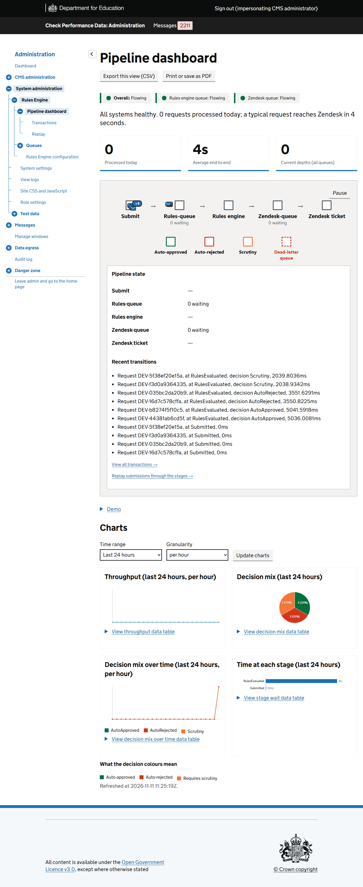
*The Pipeline dashboard, after 5 test requests had gone through the rules engine.*

The screen shows:

- **A health strip** with 3 indicators: *Overall*, *Rules engine queue* and *Zendesk queue*. Each says whether messages are flowing, or whether a queue is backing up or stalled. The thresholds for amber and red are system settings (see Appendix C).
- **A status sentence**, such as *All systems healthy*, with how many requests have been processed today and how long a typical request takes to reach Zendesk.
- **3 figures**: Processed today, Average end-to-end and Current depths (all queues).
- **The live board**, a picture of the pipeline. Requests move from Submit to Rules-queue, to Rules engine, to Zendesk-queue and to Zendesk ticket. Below them are the 3 outcomes and the dead-letter queue. Select **Pause** to freeze the moving requests while you read the board. Select **Resume** to start them again.
- **Pipeline state** and **Recent transitions**: how many messages are waiting at each stage, and the latest steps taken by recent requests.
- **Charts**: Throughput, Decision mix, Decision mix over time and Time at each stage. Choose a **Time range** (Last hour, Last 6 hours, Last 24 hours or Last 7 days) and a **Granularity**, then select **Update charts**. Each chart has a link to view its data as a table.

Select **Export this view (CSV)** to download the figures. Select **Print or save as PDF** to print the page.

A **Demo** panel appears only where the service's development tools are switched on, and never in production. It lets testers send test requests through the pipeline. Most environments do not show it.

#### Transactions

*Transactions* lists every message recorded passing through the queues, newest first.

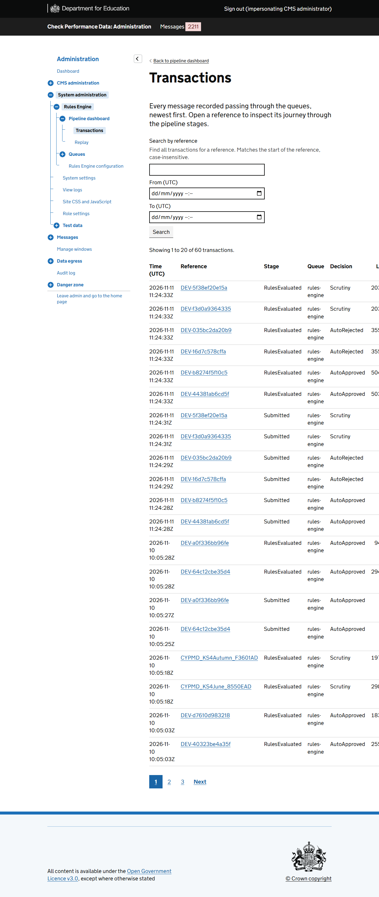
*The Transactions screen.*

To find a request:

1. Enter the start of its reference in **Search by reference**. The search matches the start of the reference and ignores capital letters.
2. If you want, enter **From (UTC)** and **To (UTC)** dates and times.
3. Select **Search**.

Each row shows the time, reference, stage, queue, decision and latency in milliseconds. Select a reference to see the journey that request took through the pipeline. The journey page shows the time of each stage and how long the request waited at it.

#### Replay

*Replay* lets you watch recent submissions move through the pipeline stages one step at a time. Use it to see how a request travelled, or to explain the process to someone.

1. Optionally, enter **From (UTC)** and **To (UTC)** and select **Filter**. Select **Reset to recent** to go back to the latest submissions.
2. Tick one or more submissions. Select **Select all on this page** to tick them all.
3. Select **Play selected**.

Replay only shows what the service has already recorded. It does not send anything again.

#### Share links and the wallboard

Share links let you show the pipeline to someone without them signing in. *Share links* has no entry in the menu. Open it by adding `/admin/share` to the address of the service. You need the *share-admin* section for your role (see Appendix B).

1. Enter a **Label** so you can recognise the link later.
2. Choose the **Surface**: *Share link* for a read-only overview of the pipeline, or *Wallboard* for a display for a wall screen.
3. Select **Generate link**.
4. Copy the link straight away. The service says *Copy this link now — it is shown once and cannot be retrieved again.*

The link shows totals only. It contains no pupil information. Anyone who has the link can open it without signing in. The *Issued links* list shows each link's label, surface, when it was created and whether it is live.

> **Warning** Select **Revoke** to switch a link off. The service does not ask you to confirm. Anyone who then uses the link sees a *Page not found* screen. You cannot switch a revoked link back on. Generate a new one instead.

### Queues

Use *Queues* to see how many messages are waiting to be processed.

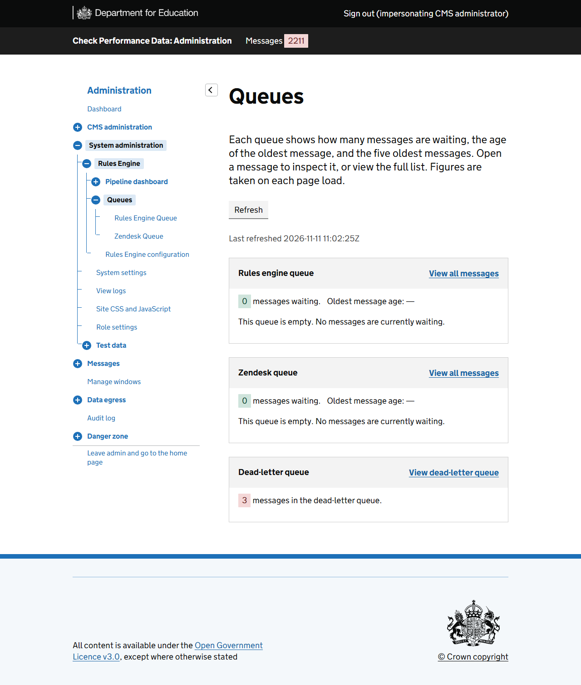
*The Queues screen.*

The screen has a section for each queue: *Rules engine queue*, *Zendesk queue* and *Dead-letter queue*. For the first two it shows the number of messages waiting, the age of the oldest message and the 5 oldest messages. The figures are taken when the page loads. Select **Refresh** to update them.

Select **View all messages** to open the full list for a queue. The list shows the messages waiting, oldest first.

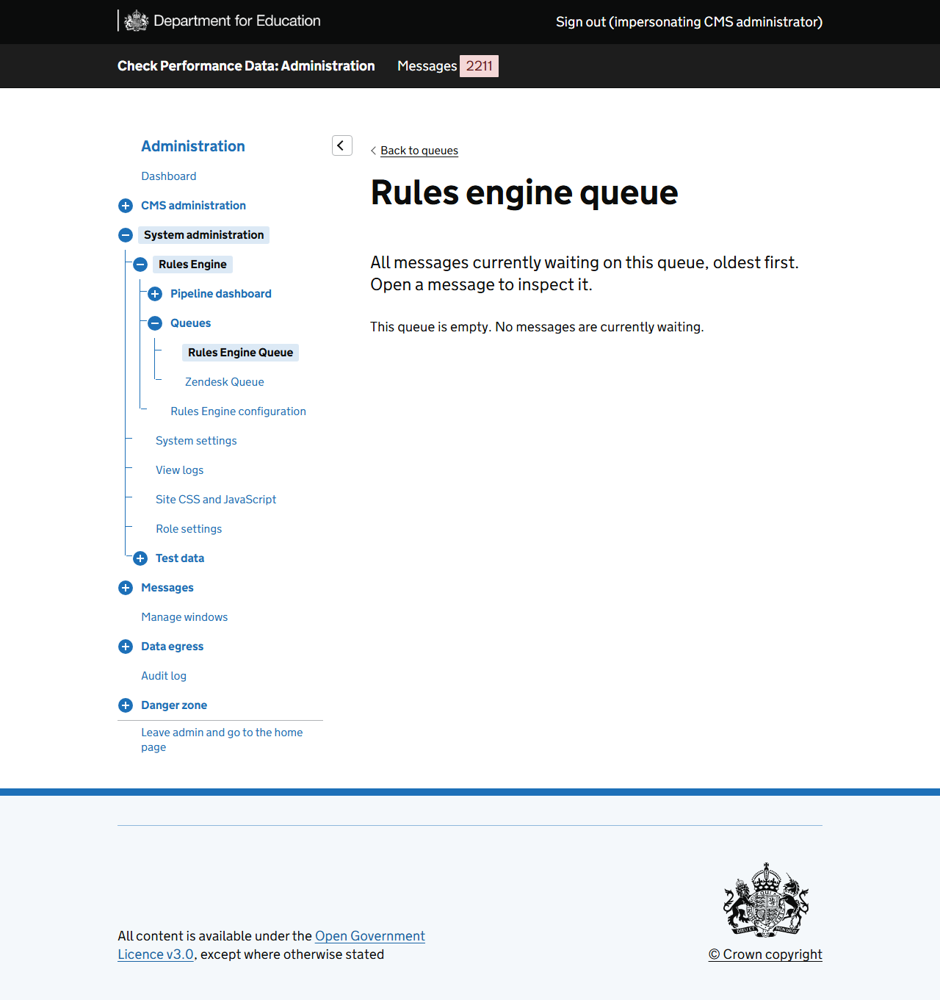
*The Rules engine queue screen when no messages are waiting.*

Select a message to inspect it. The screen hides pupil identifiers. For the dead-letter queue, select **View dead-letter queue**. Chapter 6 explains it.

### Rules Engine configuration

Use *Rules Engine configuration* to view and change the decision rules the engine follows, and the country language list it uses.

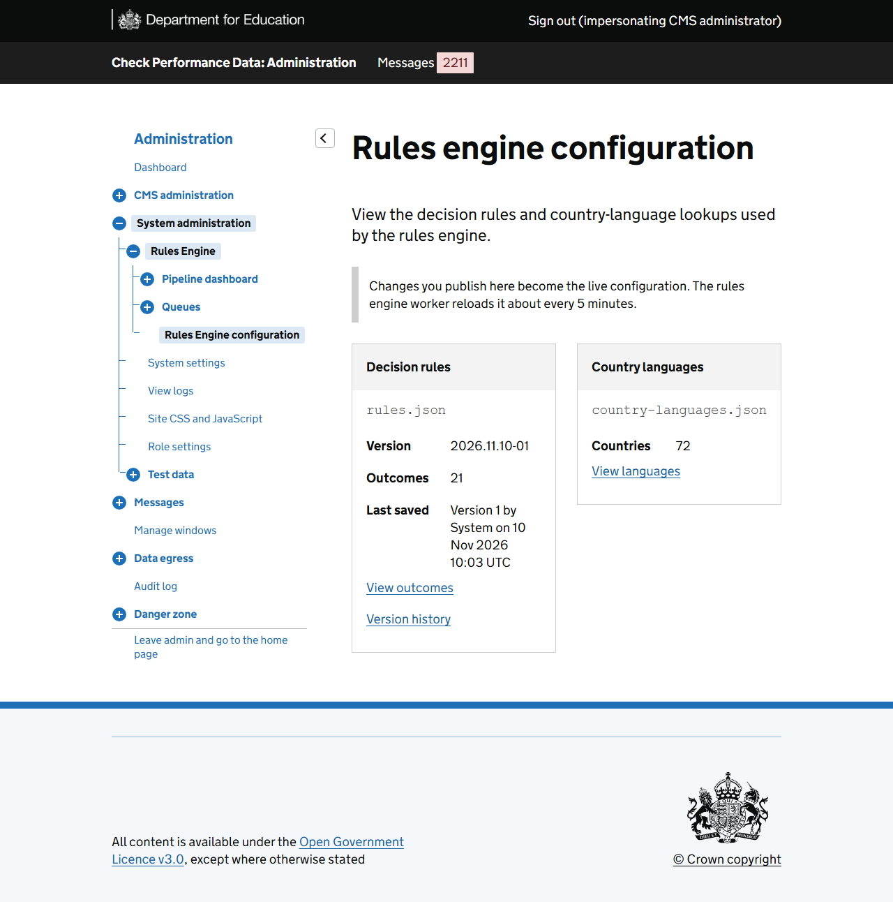
*The Rules engine configuration screen.*

The screen has 2 cards:

- **Decision rules** shows the rules version, the number of outcomes, and when and by whom they were last saved. Select **View outcomes** to change the rules. Select **Version history** to see earlier versions.
- **Country languages** shows the number of countries in the list. Select **View languages** to change the list.

Changes you publish here become the live rules. The rules engine picks them up about every 5 minutes.

An **Upload** link appears on a card only while that configuration is empty. It lets you publish a first version from a file. Once a configuration holds data, you change it on the screens described below.

#### Decision outcomes and branches

An outcome is a reason a school gives for a change, such as *Deceased* or *Not on roll*. Each outcome has one or more branches. A branch is a rule with a decision.

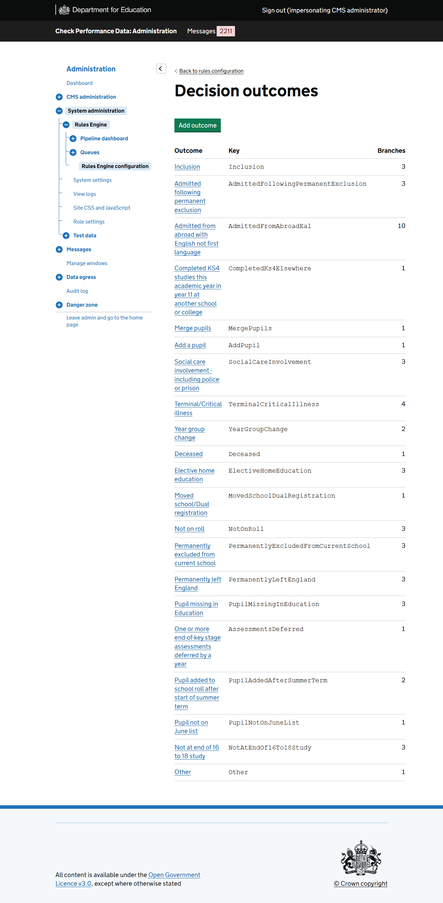
*The Decision outcomes screen.*

Select an outcome to see its branches.

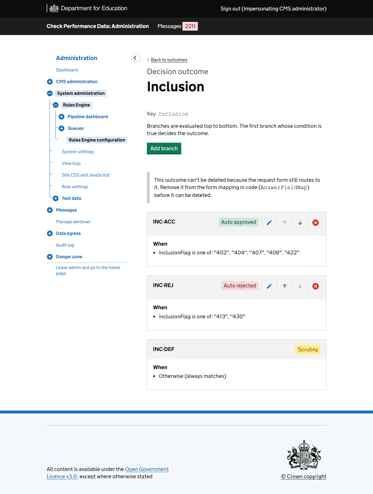
*An outcome with 3 branches. The engine checks branches from top to bottom.*

The engine checks the branches from top to bottom. The first branch whose condition is true decides the outcome. The last branch, *Otherwise*, always matches and always sends the request to Scrutiny.

To add an outcome:

1. Select **Add outcome**.
2. Enter an **Outcome key**. Use letters and numbers only, and start with a letter. The key is used in the rules and on tickets.
3. Optionally, enter a **Label**. This is the name shown in admin. It defaults to the key.
4. Select **Create outcome**.

The service adds a catch-all Scrutiny branch for you. The request form does not use a new outcome until the development team connects its key to the form. Until then, the outcome exists in the rules, but no request can use it.

To add a branch to an outcome:

1. Open the outcome, then select **Add branch**.
2. Choose the **Decision**: AutoApproved, AutoRejected or Scrutiny.
3. Build the **Condition**. Under **Match**, choose how conditions combine: *All of these*, *Any of these* or *Not (one condition)*. Select **Add condition** to add a test. For each test, choose a **Field**, then an **Operator** and a **Value**. A field is any piece of information the rules can read. It can be an answer the school gave, the window type or the request type, a value from the pupil record, or a calculated field such as `hasSupportingEvidence`. The operators on offer depend on the type of the field:
    - A text field offers *equals*, *does not equal*, *is one of*, *is known and certain* and *official language is*.
    - A number field offers *is less than*, *is less than or equal to*, *is greater than*, *is greater than or equal to*, *equals* and *is known and certain*.
    - A date field offers *is before*, *is on or before*, *is after*, *is on or after* and *equals*.
    - A yes or no field offers *equals*, *does not equal* and *is known and certain*.

    If you change the field, select **Update field** so the operators match it. Select **Remove condition** to take a test out. Select **Add group** to nest a group of conditions.
4. Select **Save branch**.

To change a branch, select its edit icon. To reorder branches, use the up and down icons. To remove a branch, select its remove icon. The service then asks *Remove branch?* Select **Remove branch** to confirm. It records a new version, and you can roll it back.

#### Deleting an outcome

1. Open the outcome, then select **Delete this outcome**.
2. Type the outcome key in the box to confirm.
3. Select **Delete outcome**.

> **Warning** Deleting an outcome removes it and all its branches from the rules. The service records a new version, so you can roll the change back from the version history. You cannot delete an outcome while the request form still routes to it. The outcome screen tells you when that is the case.

#### Country languages

*Country languages* maps each country to its official languages. One of the rule conditions uses it to check a pupil's first language.

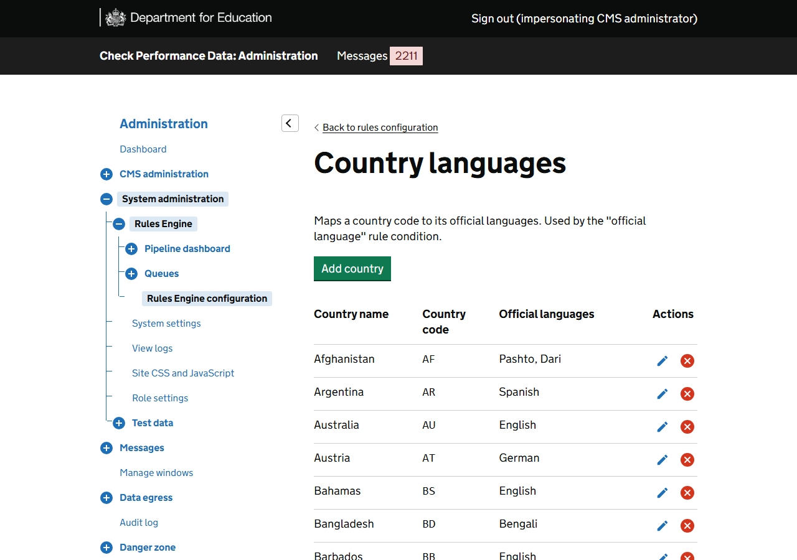
*The top of the Country languages screen. The list continues below.*

- To add a country, select **Add country**. Enter the **Country code** and one or more **Official languages**, using **Add language** for each extra one. Select **Save**.
- To change a country, select its edit icon. Change the languages, then select **Save**.
- To remove a country, select its remove icon.

> **Warning** The remove icon removes the country straight away. The service does not ask you to confirm. To bring it back, roll back to an earlier version.

#### Version history and rollback

Every change to the decision rules is saved as a new version. Select **Version history** on the *Rules Engine configuration* screen to see them.

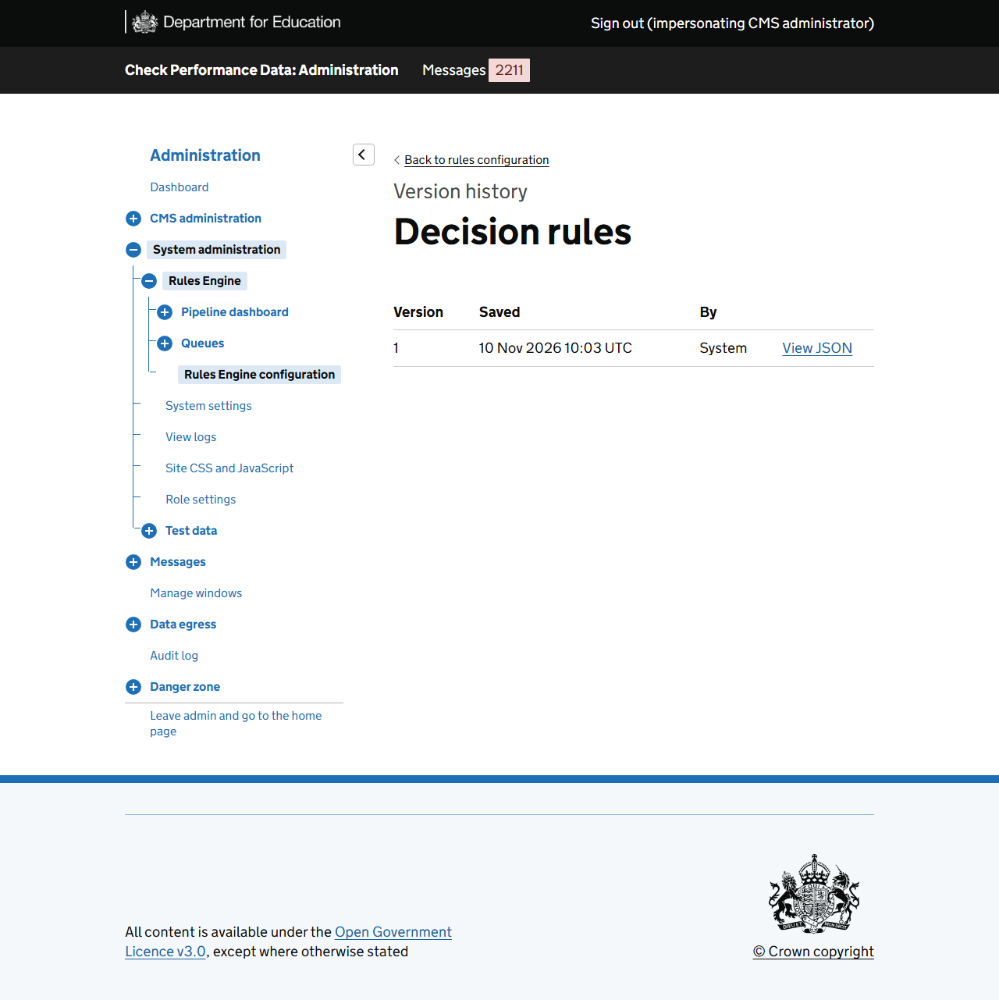
*The version history for the decision rules.*

Each version shows when it was saved and by whom. Select **View JSON** to see exactly what was saved. To go back to a version:

1. Open the version.
2. Select **Roll back to this version**.
3. On the confirmation screen, read what will happen, then select **Roll back**.

A rollback does not erase anything. It saves a new version with the older content, so you can roll forward again.

#### If someone else changed the rules first

If someone else saved a change while you were editing, the service saves nothing. It shows a message such as *The rules were changed by someone else. Nothing was saved — reload and try again.* Reload the page, check what has changed, and make your change again.

### System settings

Use *System settings* to change how the service behaves without a new release.

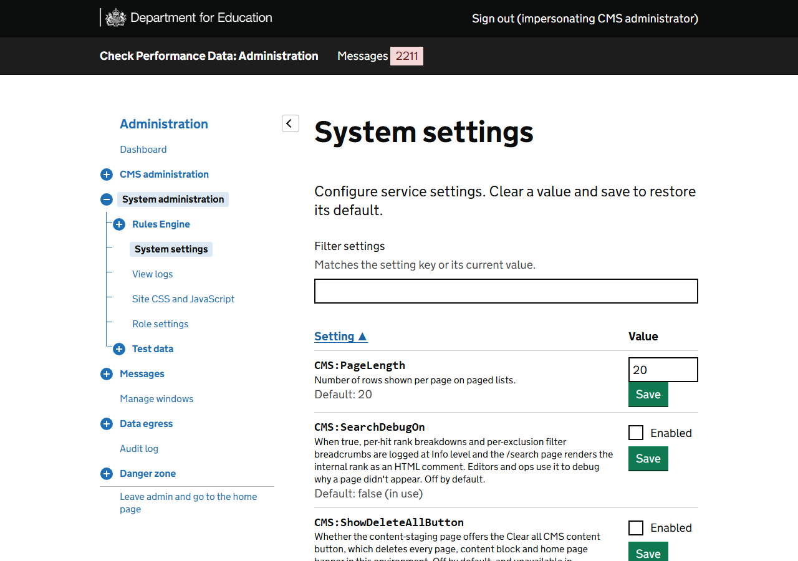
*The top of the System settings screen. The list continues below.*

The screen lists every setting with a description, its default and its current value. Enter words in **Filter settings** to find one by its name or value.

To change a setting:

1. Change its value. A tick box switches a setting on or off.
2. Select **Save** beside that setting.

Each setting saves on its own. To go back to the default, clear the value and select **Save**.

Appendix C explains every setting in plain English.

### View logs

Use *View logs* to see what the service has recorded about its own activity, and to download it. This is mainly for the development team when something has gone wrong.

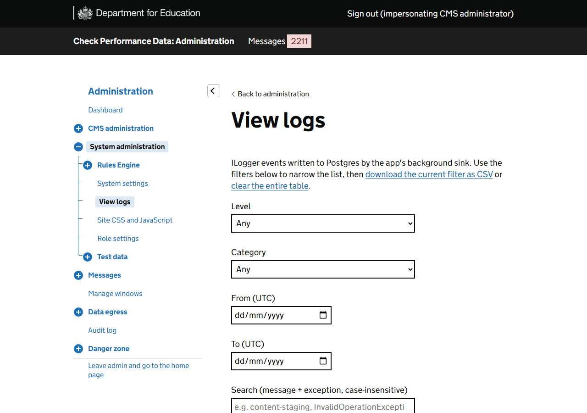
*The top of the View logs screen. The list of log entries continues below.*

The list shows the newest entries first. The number of entries on a page follows the *CMS:PageLength* system setting, which is 20 unless it has been changed. Each entry has a timestamp, a level, a category, a message and the request that caused it.

To narrow the list, use the filters: **Level**, **Category**, **From (UTC)**, **To (UTC)** and **Search**. Search looks in the message and any error text, and ignores capital letters. Select **Apply filters**, or select **Reset** to clear them.

Select **Download CSV** to download the entries that match your filters.

> **Warning** Select **Clear all logs** to delete every log entry. The service asks you to confirm with *Clear all application logs?* This cannot be undone. New entries are recorded as normal afterwards.

### Site CSS and JavaScript

Use *Site CSS and JavaScript* to add your own CSS and JavaScript to every page of the service, including the admin area and shared pages. Only administrators can use this screen, even if another role is given the `site-assets` section.

The screen has a box for the CSS and a box for the JavaScript. Each has a tick box that switches it on or off, so you can stop using it without deleting it. Each box holds up to 200,000 characters.

To change the CSS or JavaScript:

1. Change the text in the box.
2. Tick or clear **Apply the custom CSS to the site** or **Apply the custom JavaScript to the site**.
3. Select **Save**. The service confirms with *Site CSS and JavaScript saved.*

The CSS is added after the service's own styles, so its rules can override them. The JavaScript runs once each page has loaded.

> **Warning** JavaScript added here runs for every user, administrators included. Test it carefully before you switch it on.

A save takes effect straight away on the server you saved it on. On other servers it takes effect within about 30 seconds.

If a rule or script breaks a page, add `?siteAssets=off` to the end of that page's address to see it without them. The *Site CSS and JavaScript* screen itself never loads them, so you can always reach it to fix or switch off the problem.

Every save is recorded in the audit log.

### Role settings

Use *Role settings* to choose which admin sections each role can see. Chapter 1 explains roles.

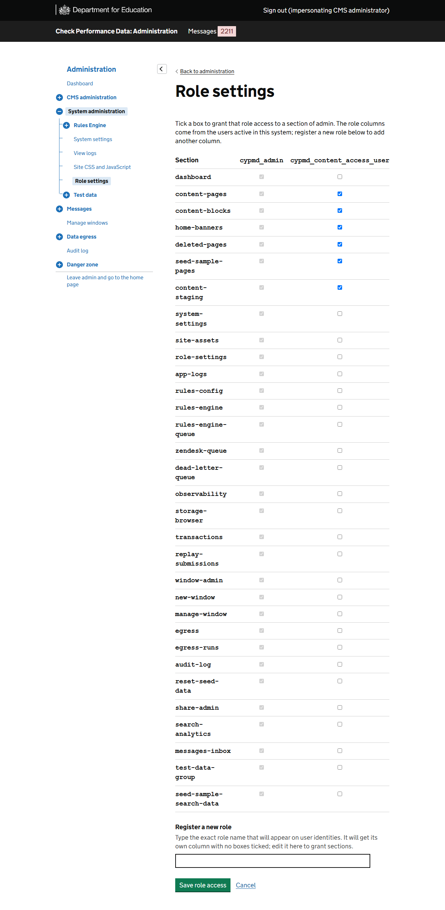
*The Role settings screen.*

The grid has one row for each admin section and one column for each role. The section names are short codes, such as `content-pages`. Appendix B explains what each one unlocks.

To change what a role can see:

1. Tick the box for each section the role should have. Clear the box for each section it should not have.
2. Select **Save role access**. The service confirms with *Role access saved.*

The `cypmd_admin` column is fixed. Administrators always have every section.

To add a role, type its name in **Register a new role**, exactly as it appears in DfE Sign-In. The role gets its own column with no boxes ticked. Tick the sections it needs, then select **Save role access**.

A change takes effect straight away on the server you saved it on. On other servers it takes effect within about a minute.

### Test data

The *Test data* group has 2 tools for filling an environment with sample content. Use them to test or demonstrate the service.

- **Seed sample CMS pages** adds a set of published sample pages under Wiki, Help, Support and Guidance. It also restores the pages used for testing. It is available in every environment except production.
- **Seed sample search data** adds made-up search events and feedback messages, so that Search analytics has something to show. It is available in development, review and QA environments only. Under **Time span preset**, choose how far back the data goes: *Last 24 hours*, *Last week*, *Last month*, *Last quarter* or *Last year*. Each preset has a usual number of events. To change the numbers, open *Advanced — override the row counts* and fill in **Events to seed** and **Feedback messages to seed**. Leave a box blank to use the preset. Select **Seed data**. The page shows how far the seeding has got, and you can cancel it.

  The page ends with a **Danger zone** heading. Both buttons there ask you to confirm, and neither can be undone. The page text says both are limited to the local development environment. In fact they work wherever the page itself is available: development, review and QA.
    - **Delete seeded data** deletes only the search events, results and feedback messages that this tool created.
    - **Delete all data** deletes every search event, result and feedback message, including real ones. You must type DELETE to confirm.

> **Warning** Sample data looks like real data. Search events and feedback messages you seed appear in Search analytics and in the Search feedback inbox, and cannot be told apart from real ones. Do not seed sample data in an environment where you need to see real figures.

## 6. Messages

This group holds what the service sends to you: feedback from people who used the search, and requests that could not be processed.

### Search feedback

*Search feedback* lists messages people sent from the search results page, using the link that asks whether the results were what they expected.

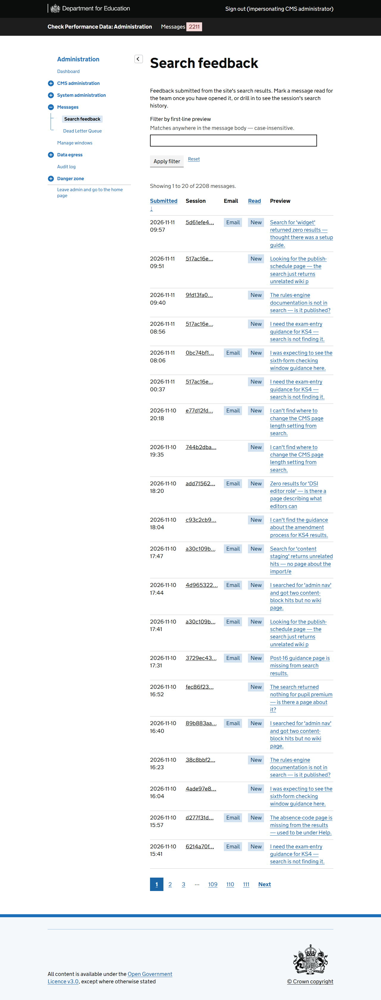
*The Search feedback screen.*

The list shows 20 messages a page. Each row shows when the message was sent, the session it came from, an *Email* tag if the person gave an email address, whether it is *New* or *Read*, and the start of the message.

- To find messages, enter words in **Filter by first-line preview** and select **Apply filter**. The filter matches anywhere in the message and ignores capital letters. Select **Reset** to clear it.
- To sort, select **Submitted** or **Read** in the column headings.

Select a message to open it. The message screen shows what the person was looking for and what they got. It also shows their last search on the site, how many results came back and what they were. Under *Message details* it shows when it was sent, the session, their email address (or that they did not want to be contacted) and the status.

- Select **Mark as read** when you have dealt with the message. The status changes to *Read*, and the screen shows who marked it. Opening a message does not mark it as read.
- Select **View this session's searches** to see everything else that person searched for.

The Messages badge in the header counts messages that are still *New*.

### Dead Letter Queue

A dead-lettered message is a request that the pipeline could not process, even after several attempts. The service moves it to the dead-letter queue so that it is not lost. Someone then decides whether to try it again or to delete it.

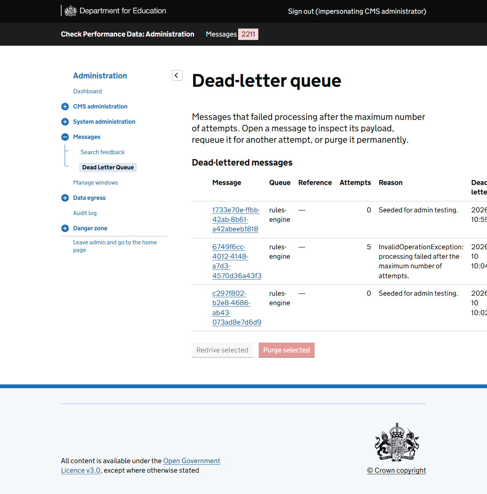
*The Dead-letter queue screen.*

Each row shows the message ID, the queue it came from, its reference, how many attempts were made, the reason it failed and when it was dead-lettered.

To try a message again:

1. Select **Redrive** on its row. To try several, tick them and select **Redrive selected**.
2. Read the confirmation. The service asks *Requeue this message?* and warns that trying again may create a downstream effect, such as a support ticket.
3. Select **Yes, requeue**.

The message goes back to the queue it came from for another attempt.

To open a message, select its ID. The detail screen shows the reason, the number of attempts and the payload, with a **Redrive** button. The payload hides pupil identifiers. An administrator can allow the full payload to be shown by turning on the *Dlq:FullPayloadEnabled* setting in System settings. Every time someone views a full payload, the service records it in the audit log.

> **Warning** Select **Purge** to delete a message from the dead-letter queue for good. To delete several, tick them and select **Purge selected**. The service asks you to confirm with *Purge this message?* This cannot be undone. The service keeps a record in the audit log that you purged it. Do not purge a message until you know that the request it carries has been dealt with another way.

The dead-letter queue also sends an email alert when it holds too many messages, and deletes old messages after a set number of days. Both are system settings (see Appendix C).

## 7. Manage windows

A checking window is a period when schools can check their data and ask for changes. *Manage windows* is where you set windows up, load the data schools see, and close them when the period ends.

### Windows, checking exercises and data files

A **window** has:

- a **title**, such as *Key Stage 4 June*
- a **window type**: Key Stage 4 June, Key Stage 2, Post 16 or Key Stage 4 Autumn
- a **key stage**: Key stage 2, Key stage 4 or Post 16. The service works it out from the window type.
- a **turnaround commitment**: a short sentence that tells schools when to expect changes, such as *updated in the Autumn*
- a **next opportunity**: an optional month and year. Once the window's pupil data checking has closed, schools see when they can next review their data. They see the month and year only, for example *October 2027*.

The window type decides which changes a school can ask for in pupil data checking. There is no setting for this.

| Window type | Changes a school can ask for |
|---|---|
| Key Stage 2 | Remove |
| Key Stage 4 June | Merge, Include, Remove and Add |
| Key Stage 4 Autumn | Merge, Include, Remove and Add |
| Post 16 | Merge, Include and Remove |

A window holds one or more **checking exercises**. Each exercise has its own opening and closing date and time. The window's start and end dates are worked out from its exercises, so you do not enter them.

Each exercise has one of these types:

- **Pupil data checking**: schools check their pupil data and ask for changes.
- **Results enquiry**: schools ask about results.
- **No exercise type (display only)**: a data share. Schools can view and download the data, but they cannot ask for changes. Admin screens show its type as *Data share*. For example, the *Summary* exercise of a Key Stage 2 window is a data share.

A window can have only one Pupil data checking exercise and one Results enquiry exercise. It can have any number of data shares.

Each exercise holds **data files**. Each data file needs 2 files:

- a **CSV**: the data itself. You choose it from the ingress storage area. You do not upload it from your own computer. The service copies it into the window's own storage and records a checksum, which lets it tell later if the file has changed.
- a **JSON schema**: a file that describes what the data should look like and how schools see it. You upload this from your computer.

Each data file is *Required* or *Optional*. An optional file is one the supplier may send later, or not at all. You can validate without it.

Each data file is also used for one of 2 things:

- *Journey*: its records feed the journeys schools use to ask for a change or make an enquiry.
- *Data share*: schools can view and download it, but no journey uses it.

When the files are in place, you **validate** the exercise. Validation checks every record against its schema. Each validation that passes makes a new **release** of the data, and schools see it at once. When the exercise ends, the service sends the requests schools have submitted for processing. You can also close an exercise early.

#### What a new window starts with

When you create a window, the service gives it the checking exercises and data files below. Add the other data files the window needs from the exercise's **Data** tab. Add a data share, such as *Summary*, with **Add checking exercise**. The create pages never add one.

| Window type | Checking exercises | Data files |
|---|---|---|
| Key Stage 2 | Pupil data checking | None. Add the pupil files. |
| Key Stage 4 June | Pupil data checking | One file, *Pupils*, which feeds the journeys. |
| Key Stage 4 Autumn | Pupil data checking and Results enquiry | Pupil data checking: none. Results enquiry: *Main results (KS4_MAIN)*, which is required, and *Late results 1 (KS4_LR1)*, *Late results 2 (KS4_LR2)* and *Revised results (KS4_Revised)*, which are optional. |
| Post 16 | Pupil data checking and Results enquiry | Pupil data checking: none. Add the included and non-included student files. Results enquiry: 7 results files. *Included (16to19_INC)*, *Non-included (16to19_NONINC)* and *Late results 1 (16to19_LR1)* are required. The 2 revised files, the revised file with retention and *Late results 2 (16to19_LR2)* are optional. |

A Results enquiry exercise that you add to a window later starts with the same results files. A Results enquiry on a Key Stage 2 window has none, because Key Stage 2 has no results files.

Every exercise the create pages make is hidden from schools at first. Schools see it only after you tick **Enable this exercise for schools** on the exercise's **Dates** tab.

### The Manage windows screen

Select **Manage windows** on the Administration page to see every window and its checking exercises.

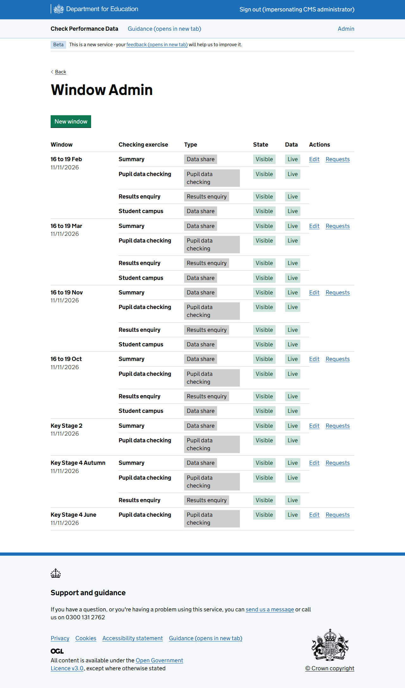
*The Manage windows screen. The screen title is Window Admin.*

The screen opens in the public layout of the service, without the admin side menu. Select **Back** to return to the Administration page.

**New window** starts the pages that create a window. You see it only if your role has the `new-window` section.

The table has one row for each checking exercise. The window's name, its start date and its actions span all of its rows.

| Column | What it shows |
|---|---|
| Window | The window title, with its start date beneath. |
| Checking exercise | The exercise name. A window with no exercises shows *No checking exercises*. |
| Type | *Pupil data checking*, *Results enquiry* or *Data share*. |
| State | What schools can see now: *Visible*, *Visible – closed* or *Hidden*. See the table below. |
| Data | Whether schools have data from this exercise: *Live*, *Live – new files not validated*, *Not validated* or *No files*. See the table below. |
| Actions | **Edit** opens the window summary. **Requests** opens the list of requests made in the window. |

The State tags mean:

| Tag | What it means |
|---|---|
| *Visible* | Schools can see the exercise. For Pupil data checking or Results enquiry, they can also make requests, because the exercise is between its opening and closing dates. A data share is always *Visible* when schools can see it. |
| *Visible – closed* | Schools can see the exercise and its data, but they cannot make requests, because the exercise is outside its dates. |
| *Hidden* | Schools cannot see the exercise. It is not enabled, it is outside its *Visible from* and *Visible until* dates, or schools cannot see the window at all. |

The Data tags mean:

| Tag | What it means |
|---|---|
| *Live* | Schools see the data from the files the exercise now holds. |
| *Live – new files not validated* | Schools see a release, but at least one file has changed since. Validate the exercise to make the new files live. |
| *Not validated* | The files are in place, but no validation has passed yet. Schools see no data. |
| *No files* | No data file has both a CSV and a schema. |

### Creating a new window

Select **New window** on the *Manage windows* screen. The service takes you through the pages one question at a time. It only creates the window on the last page.

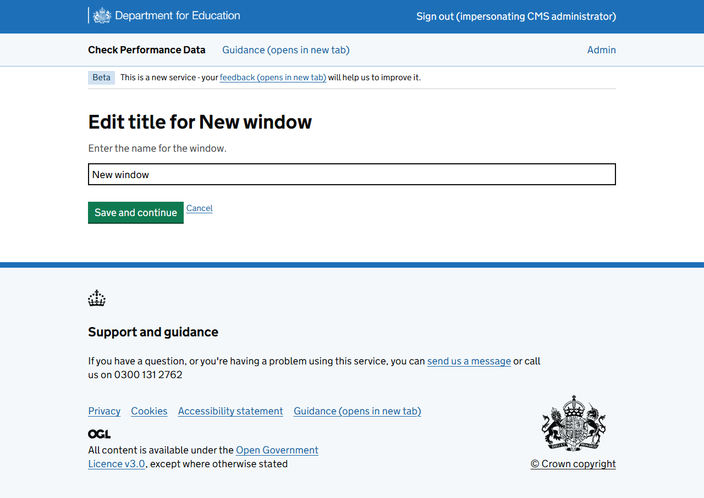
*The first page: the window title.*

1. **Edit title for New window.** Enter the name for the window. It starts as *New window*. Select **Save and continue**.
2. **Select the window type.** Choose Key Stage 4 June, Key Stage 2, Post 16 or Key Stage 4 Autumn. Select **Save and continue**. The window type decides the key stage and the checking exercises the window starts with.
3. **Dates.** The service asks for the dates of each exercise in turn, on a page such as *Pupil data checking dates*. Enter **When does it open?** as a day, month and year. Enter **What time does it open?** as an hour and minute on the 24-hour clock, such as 09 30 or 17 00. Then do the same for **When does it close?** and **What time does it close?** The times start as 00 00 and 17 00. Select **Save and continue**.
4. **Check your answers.** The page lists the title, window type, key stage, checking exercises and the dates of each exercise. Select **Change** beside the title, the window type or an exercise's dates to correct it. The key stage and the checking exercises have no **Change** link, because they come from the window type. When everything is right, select **Save and continue**.

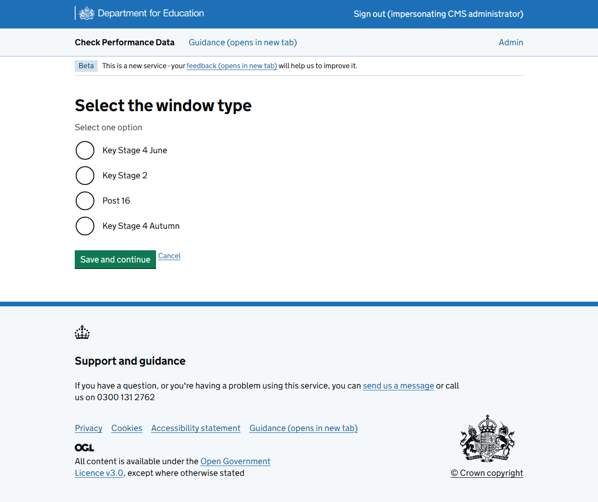
*The window type page.*

The dates page rejects an opening date in the past, with the message *Start date can not occur in the past.* It also rejects a closing date before the opening date, with *End date can not occur before the start date.*

Selecting **Save and continue** on *Check your answers* creates the window and its storage. The service then opens the window summary page.

The service does not ask for a turnaround commitment or a next opportunity in these pages. Add them afterwards from the window summary.

#### Leaving the create pages part-way

The service keeps your answers for the rest of your session. The window is not created until you complete the last page, so leaving does not affect any existing window. Select **New window** again to start with no answers.

To discard your answers, select **Cancel** on the title page or on a dates page. If you have saved any answers, the service shows *Do you want to delete this window?* with the answers so far:

- Select **Delete** to discard your answers. The service opens the Administration page.
- Select **Continue** to go back to the next page you have not answered.

If you have not saved any answers, **Cancel** on the title page opens the Administration page.

> **Warning** 2 of the Cancel links do not work as you would expect at present. On the *Select the window type* page, **Cancel** shows a *Page not found* screen. On the *Check your answers* page, **Cancel** shows the same page again. To leave from either page, select **Back** on *Check your answers*, or use the links in the header.

### The window summary page

Select **Edit** on a window in *Manage windows* to open its summary. This is where you manage the window from day to day.

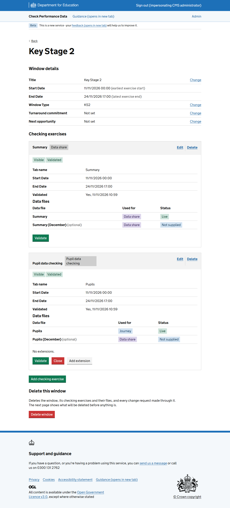
*The summary page for a window with 2 checking exercises.*

The first section, *Window details*, lists:

- **Title**, with a **Change** link
- **Start Date** and **End Date**: the earliest exercise start and the latest exercise end. They have no **Change** link, because they come from the exercises.
- **Window Type**, with a **Change** link. The page shows the type as a short code, such as *KS2*, *KS4June*, *KS4Autumn* or *Post16*.
- **Turnaround commitment**, with a **Change** link. It says *Not set* until you add one.
- **Next opportunity**, with a **Change** link. It says *Not set* until you add one.

If you change the window type, the window keeps its exercises. The service changes the Results enquiry's results files to those of the new type.

Under *Checking exercises*, each exercise has a card, in the order schools see the tabs. The card title shows the exercise name and its type. The card has 2 links:

- **Edit** opens the exercise's edit page, where you change everything about the exercise, including its dates and data files.
- **Delete** opens a page that asks you to confirm. See "Deleting a checking exercise or a window" later in this chapter.

The card starts with 2 tags. The first is the State tag, as on *Manage windows*: *Visible*, *Visible – closed* or *Hidden*. The second says whether the exercise is validated:

- *Validated*: the last validation read the files the exercise now holds.
- *Files changed since validation*: someone has changed a file since the last validation. Validate again.
- *Not validated*: no validation has passed.

The card then shows:

- **Tab name**: the label schools see on the exercise's tab
- **Start Date** and **End Date**
- **Validated**: *Yes* with the date and time, *No*, or *Not since the files changed* with the date and time of the last validation
- a *Data files* table, with each data file's name, what it is **Used for** (*Journey* or *Data share*) and its **Status**. An optional file shows *(optional)* after its name. A retired file is not listed here. An exercise with no data files says *This exercise has no ingress files to load.*
- for Pupil data checking and Results enquiry only, an *Extensions* table, or the words *No extensions.*

The data file Status tags mean:

| Tag | What it means |
|---|---|
| *Live* | Schools see this file. It is in the live release. |
| *Not validated* | The file has a CSV and a schema, but they are not in the live release. Validate the exercise. |
| *Not supplied* | The CSV, the schema or both are missing. |
| *Retired* | Another file replaces this one. No validation reads it. Only the exercise's **Data** tab shows this tag. |

The buttons at the bottom of the card are:

- **Validate**: shown on every card. It is greyed out until every required data file has a CSV and a schema, and once the exercise's closing date has passed. To validate after the closing date, use **Validate data** on the exercise's **Data** tab.
- **Close**: for Pupil data checking and Results enquiry, while the exercise is between its opening and closing dates.
- **Send requests for processing**: for Pupil data checking and Results enquiry, once the exercise has closed.
- **Add extension**: for Pupil data checking and Results enquiry, at any time.

Below the cards:

- **Add checking exercise** adds an exercise to the window, such as a data share.
- *Delete this window* has a **Delete window** button.

### Adding or editing a checking exercise

Select **Add checking exercise** on the window summary to add an exercise. Select **Edit** on an exercise's card to change one. Both open the same page, headed *Add checking exercise* or *Edit checking exercise*, with 3 tabs: **Exercise Details**, **Dates** and **Data**.

When you add an exercise, the **Data** tab is empty. Select **Add checking exercise** at the bottom of the page to save it. Then select **Edit** on its card to add its data files. A new Pupil data checking exercise or data share has no data files. A new Results enquiry starts with the window type's results files.

When you edit an exercise, select **Save changes** at the bottom of the page to save the **Exercise Details** and **Dates** tabs. Select **Cancel** to leave without saving. The **Data** tab saves each change as you make it, on its own pages. Save any changes on the other 2 tabs before you choose files.

#### The Exercise Details tab

- **Exercise name**: the name admins see, for example *Provisional students*.
- **Exercise type**: **No exercise type (display only)**, **Pupil data checking** or **Results enquiry**. You must choose a type unless you tick **Display data only**. A window can have only one exercise of each type. You cannot change the type once the exercise has live data or schools have made requests on it. Add a new exercise instead.
- **Tab name**: the label schools see on the tab, for example *Students* or *Results*.
- **Tab order**: lower numbers appear first, on the school's checking data page and on the window summary.
- **Display data only**: schools can view and download the data, but cannot start a journey.
- **Show late results warning**: on a Results enquiry, when you edit it. Before an incorrect grade enquiry, schools are told that late results may still correct the grade. A new Results enquiry starts with the box ticked. Clear it when the late results have arrived.
- **How schools see the data**: this applies to every data file in the exercise.
    - **Table**: many records for each school. Schools choose a data file, then search and page through it.
    - **Summary list**: one record for each school, shown as labels and values. Use this for a summary.
    - **Included and non-included tabs**: 2 tables, each on its own tab. A pupil goes on a tab by P_INCL, or by the file's inclusion setting. Use this for Key Stage 4 pupil data.

#### The Dates tab

Under *Exercise dates*, enter **When does it open?**, **What time does it open?**, **When does it close?** and **What time does it close?** These dates make up the window's dates. For an exercise with a journey, they also decide when schools can make requests. A display-only exercise never accepts requests.

If the closing date is before the opening date, the page says *End date cannot occur before the start date*. When you add an exercise, the opening date cannot be in the past. If it is, the page says *Start date cannot occur in the past*. When you edit an exercise, you can change the dates of an exercise that has already opened.

Under *Visibility*:

- **Enable this exercise for schools**: schools see nothing of the exercise until you tick this.
- **Visible from (optional)**: the exercise is visible from this date and time, when it is enabled. Leave it blank for no start limit. When you add an exercise, you enter a date only, and it starts at midnight.
- **Visible until (optional)**: the exercise is hidden from this date and time. A date after the exercise closes keeps the window on the school's landing page, read only, until then. Leave it blank to hide it when the window closes. *Visible until* must be after *Visible from*.
- **Replaces exercise (optional)**: choose an exercise in this window that this one replaces. This records the link only. It does not hide the earlier exercise or copy its data.

Visibility is separate from the checking dates. Schools can view and download the data after checking closes.

#### The Data tab

The **Data** tab lists the exercise's data files and its data releases.

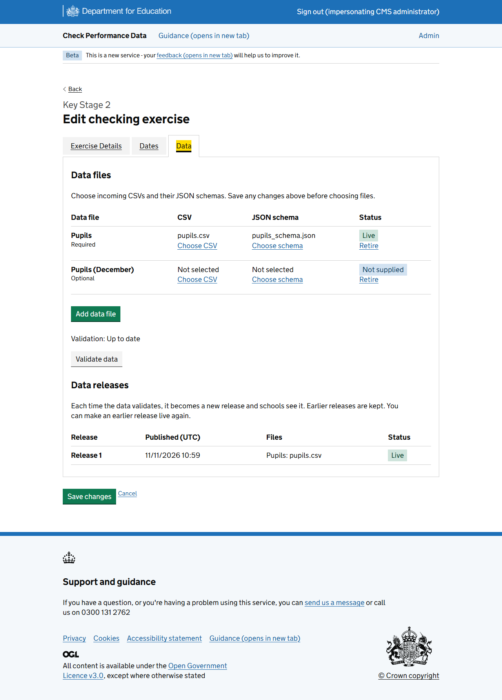
*The Data tab, with the Data releases table below the data files.*

The *Data files* table has one row for each data file:

| Column | What it shows |
|---|---|
| Data file | The file's name, with *Required*, *Optional* or *Retired* beneath. |
| CSV | The CSV file name, or *Not selected*, and a **Choose CSV** link. |
| JSON schema | The schema file name, or *Not selected*, and a **Choose schema** link. |
| Status | *Live*, *Not validated*, *Not supplied* or *Retired*, with a **Retire** link, or **Put back in use** for a retired file. |

Below the table:

- **Add data file** adds a new data file to the exercise.
- The *Validation* line says *Up to date*, *Files have changed since the last validation* or *Not yet validated*.
- **Validate data** opens the validation page. It is greyed out until every required data file has a CSV and a schema.
- The *Data releases* table. See "Validating data and data releases" later in this chapter.

#### Adding a data file

1. On the **Data** tab, select **Add data file**.
2. Enter a **Data file name**. Use a short name, such as *Included pupils*. On a Results enquiry, schools see this name as the source of each result in the file. The name must be 50 characters or fewer, must not contain `/` or `\`, and must be different from the exercise's other data files.
3. Leave **This file is required before the exercise can be validated** ticked, or clear it for an optional file.
4. On Pupil data checking or a Results enquiry, answer **What is this file for?**:
    - **Pupil data for the journeys** (on Pupil data checking) or **Results for the enquiry** (on a Results enquiry): the file is merged with the exercise's other journey files.
    - **Data share only**: schools can view and download it, but no journey uses it, for example previously published data.
5. For pupil data for the journeys, answer **Pupil inclusion**: **Use the CSV's values**, **All pupils are included** or **All pupils are not included**.
6. Select **Add data file**.

If the exercise already has files that feed the journey, the page warns you that the new file will be merged with them, and lists them. Tick **Yes, add this file to the journey data** to go on. If the new file replaces one of them, retire the old file after you add this one.

The service returns you to the **Data** tab. Choose the new file's CSV and schema next.

#### Choosing a CSV

1. On the **Data** tab, select **Choose CSV** beside the data file.
2. On *Browse ingress files for* and the data file's name, choose a storage container from the list.
3. Open folders until you find the file. Select **Back** to go up one folder, or **Back to Containers** to start again.
4. Under **Select a file**, choose the file.
5. Select **Use selected file**.

The service copies the file into the window's own storage and records its checksum. Then it returns you to the **Data** tab. Nothing is uploaded from your computer. If you select **Use selected file** without choosing a file, the page opens again.

The screen says *No ingress containers were found* if the ingress storage area is empty. Whoever supplies the data has to place the file there first.

#### Uploading a schema file

1. On the **Data** tab, select **Choose schema** beside the data file.
2. On *Upload a JSON schema file for* and the data file's name, choose the file from your computer.
3. Select **Save and continue**.

The service checks that the file is a valid JSON schema. If you do not choose a file, the page says *Select a JSON schema file*. Then it returns you to the **Data** tab.

### Validating data and data releases

#### Validating an exercise

Validation checks every record of every data file in use against its schema. Validate an exercise after you choose or change any of its files. An empty optional file is left out.

1. Select **Validate** on the exercise's card on the window summary, or **Validate data** on its **Data** tab.
2. On the page headed *Validate* and the exercise type, such as *Validate Pupil data checking*, select **Run validation**.
3. Watch the progress. The page counts *Records read*, *Records processed*, *Files written* and *Errors* as it goes.
4. When it finishes, read the result. *Validation complete* means no errors. *Validation failed* means at least one error, and the page describes what was wrong.
5. The page lists *Records processed per LAESTAB*: one row for each school, with the number of records checked, and a total.
6. Select **Return to the checking window** to go back to the window summary.

Without JavaScript the page works differently. There is no live progress. The result appears once validation has finished.

If validation fails, schools keep the data they saw before. Fix the data at source, put the corrected file in the ingress storage area, choose it again with **Choose CSV**, and validate again.

#### Data releases

Each validation that passes makes a new release, and schools see it at once. The service keeps the earlier releases. You do not need to make a release live after a validation.

The *Data releases* table on the **Data** tab lists the releases, newest first. Each row shows the release number, when it was published (in UTC) and by whom, and the CSV of each data file it read. The live release shows a *Live* tag. Every other release has a **Make live** link.

To put an earlier release back:

1. Select **Make live** beside the release.
2. Read the confirmation page, for example *Make release 1 live*. It shows when the release was published and its files. It says which release stops being live.
3. Select the button, for example **Make release 1 live**, or select **Cancel**.

Schools see the data from that release at once. The page titles and columns come from that release's schemas. Change requests schools have already submitted do not change. The release that was live is kept, so you can make it live again. The data files may then show *Not validated*, because the files they now hold are not in the live release.

### Replacing a data file

A replacement file goes in a data file of its own. Do not choose the new CSV for the old data file. Then:

1. Choose the new file's CSV and schema.
2. Retire the old data file.
3. Validate the exercise.

Schools keep the live release until the validation passes. Then they see the new release, without the retired file.

To retire a data file:

1. On the **Data** tab, select **Retire** beside the data file.
2. Read the page headed *Retire* and the data file's name. It says that the next validation makes a release without the file, and that schools keep the live release until then.
3. Select **Retire data file**, or select **Cancel**.

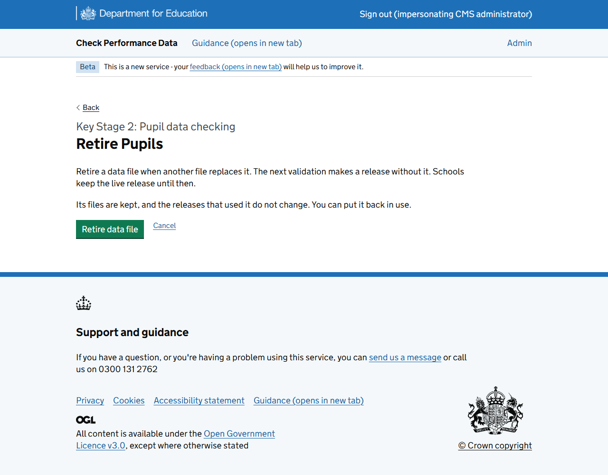
*The page for retiring a data file.*

The retired file's files are kept, and the releases that used it do not change. A retired file does not stop validation, even if it is required.

You can undo retiring. Select **Put back in use** beside the retired file, then select **Put back in use** on the next page. The next validation reads the file again, if it has a CSV and a schema.

#### The December files for Key Stage 2

A Key Stage 2 window gets new pupil and summary files in December. Each December file replaces the September file. Each exercise has a data file for each month:

- The *Pupil data checking* exercise has *Pupils* (September, required, used for the journeys) and *Pupils (December)* (optional, a data share). Schools only view and download the December file. It does not feed the journeys, because the exercise has closed by December.
- The *Summary* data share has *Summary* (September, required) and *Summary (December)* (optional).

The December data files wait empty until December. An empty required file would stop the September validation, so they are optional.

In December, do these steps for the *Pupil data checking* exercise, then for *Summary*:

1. On the window summary, select **Edit** on the exercise's card. Select the **Data** tab.
2. Select **Choose CSV** on the December row. Choose the December CSV and select **Use selected file**.
3. Select **Choose schema** on the December row. Upload the December schema and select **Save and continue**.
4. Select **Retire** on the September row (*Pupils* or *Summary*). Select **Retire data file**.
5. Select **Validate data**, then **Run validation**.

Use **Validate data** on the **Data** tab. By December the exercise has closed, so the **Validate** button on the window summary is greyed out.

Schools keep the September data until the validation passes. In a test environment with seed data, the December sample files are in the `ks2` ingress container: `pupils/pupils-december.csv` and `summary/summary-december.csv`.

#### Pupil data for Key Stage 4 Autumn

Give the Key Stage 4 Autumn pupil file the Key Stage 4 Autumn pupils schema, and validate it. That schema says which not-included pupils a school can ask to include. Do not use the Key Stage 4 June schema. Pupil data validated before the service marked which pupils can be included has nobody to include, so the Include journey finds no pupils. If schools say that the Include journey finds nobody, validate the pupil data again.

### Closing an exercise early

Use this to stop schools using an exercise before its scheduled end. You can only close a Pupil data checking or Results enquiry exercise while it is open.

1. Select **Close** on the exercise's card.
2. Read the confirmation page, for example *Close Pupil data checking early?*. It shows the window, the exercise and its scheduled end.
3. Under **To confirm, type the window name**, type the window's name exactly as the page shows it. Capital letters matter.
4. Select the button, for example **Close Pupil data checking**, to confirm, or select **Cancel** to go back.

If the name you type does not match, the exercise stays open. The page shows *The window name you entered does not match*. Correct the name and try again.

> **Warning** You cannot undo closing an exercise. From that moment schools cannot make new requests for it, and any school part-way through a request is stopped on its next page. The service also sends every request schools have submitted for processing, and cancels drafts that a school has not submitted. Submitted requests cannot be changed afterwards. Cancelled drafts cannot be resumed. Schools in an open extension keep their extra time.

After it closes, the summary page shows a *Success* banner, for example *Pupil data checking was closed early on 03/09/2026, 10:39 by Sam Taylor. 1 request sent for processing and 10 drafts cancelled.* The exercise's **End Date** becomes the time you closed it, and the **Close** button is no longer shown. The close is recorded in the audit log.

The banner and the end date show UK time.

If the service closes the exercise but cannot send its requests for processing, the summary page shows an *Important* banner instead. It says the exercise was closed and that its requests could not be sent. The exercise is closed. Select **Send requests for processing** on the exercise's card to try again.

### Sending requests for processing after an exercise has closed

When an exercise reaches its end, the service sends its requests for processing by itself, two hours later. It also cancels drafts that schools have not submitted. You do not need to do anything.

Use the button if you want the requests sent before the two hours are up, or if you think some were missed.

1. Select **Send requests for processing** on the exercise's card. The button appears once the exercise has closed.
2. Read the confirmation page. It says how many *Requests to send for processing*, how many *Requests waiting for the Rules Engine* and how many *Drafts to cancel*.
3. Select **Send requests for processing** to confirm, or select **Cancel** to go back.

> **Warning** You cannot undo this. Submitted requests are sent for processing and cannot be changed afterwards. Drafts that a school has not submitted are cancelled, and cannot be resumed.

A request a school submitted only moments before the close may still be waiting for the Rules Engine. The page and the message after sending say how many are waiting. They are not lost: select **Send requests for processing** again later to send them.

You do not need to do this after closing an exercise early, because closing it early also sends its requests. If there is nothing left to send, the confirmation page says so.

The two hours are counted from the end time shown on the page, which is UK time.

### Extending an exercise for named schools

Use an extension to give some schools more time on a Pupil data checking or Results enquiry exercise. You name the schools and set a later end date. Every other school still sees the exercise close on its original date. A data share cannot have extensions.

Each exercise's card on the window summary has an **Extensions** table, or says *No extensions.*

**Add an extension**

1. Select **Add extension** on the exercise's card. You can add one before, during or after the exercise's end.
2. Enter the date and time the extension ends. It must be later than the exercise's own end, which the page shows. If it is not, the page says *The extension must end after the exercise ends on* and the exercise's end. It must also be in the future. If it is not, the page says *The extension end date must be in the future*.
3. Under **Schools**, enter one LAESTAB on each line, as `933/4290` or `9334290`. Both forms work. A school can be in only one extension of an exercise. If you enter a school that is already in another one, the page names it and gives that extension's end date.
4. Select **Save extension**.

If a school has no data file in the exercise's current release, the page shows a warning and lists those schools. If the exercise has no release yet, it says so and lists every school. A school may get its file in a later release, so you can still add it. Tick **Add these schools anyway** and select **Save extension** again. If you select it without ticking the box, nothing is saved and the page shows an error.

After it saves, the summary page shows a *Success* banner, for example *Extension added for 2 schools, ending 12/11/2026 17:00.* The extension appears in the **Extensions** table with its end date, the number of schools and a status of *Open* or *Closed*.

**Edit an extension**

Select **Edit** beside an open extension. You can change the end date and the list of schools. The end date must still be later than the exercise's end and in the future. The page shows the schools in the form `933/4290`. Select **Save extension**. The warning about schools with no data file works as it does when you add, but the tick box is labelled **Save these schools anyway**. If someone else changed the extension while you had it open, the page says so. Check the extension and try again.

If you remove a school after the exercise's requests were sent automatically, use the exercise's **Send requests for processing** to send that school's requests.

You cannot edit an extension that has closed.

**Close an extension early**

1. Select **Close early** beside an open extension.
2. Read the confirmation page. It shows the extension's scheduled end and how many schools are in it.
3. Under **To confirm, type the window name**, type the window's name exactly as the page shows it. Capital letters matter.
4. Select **Close extension**, or select **Cancel** to go back.

> **Warning** You cannot undo closing an extension. Its schools lose the extra time at once, and any school part-way through a request is stopped on its next page.

If the exercise itself has not ended yet, its schools keep the exercise's own time. An extension never gives a school less time than the exercise. The extension shows as *Closed*, with the words *Ends with the exercise on* and the exercise's end date in place of any links, until the exercise ends.

Closing an extension early does not send its requests for processing. Send them as described next, or leave it to the service.

**Send an extension's requests for processing**

When an extension's schools reach the end of their time, the service sends their requests for processing by itself, two hours later, and cancels their drafts. You do not need to do anything. Their time ends at the extension's end date, or at the exercise's end date if that is later.

To send them sooner, or if you think some were missed, select **Send requests for processing** beside the closed extension, read the counts on the confirmation page, and select **Send requests for processing** to confirm. The link appears only once both the extension and the exercise have ended. This works as it does for an exercise. The warning above about sending requests applies here as well.

Once an extension's requests have been sent, the table shows *Requests sent* beside *Closed*. The link stays, so you can send again if needed. Sending again does no harm.

Until an extension's requests have been sent, closing the exercise leaves its schools' requests alone. Only the extension sends them. The page for closing the exercise early tells you when an open extension's schools keep their extra time.

**What the schools see**

A named school sees only the new end date, wherever the service shows the exercise's deadline, including on confirmation pages and in emails. It is not told that it has an extension. Every other school sees the exercise's own end date. When the extension ends, the school sees the exercise as closed.

**The audit log**

Each change appears in the audit log, under the **Window admin** activity, with your name: an extension added, edited, closed early, and its requests sent for processing. When the service sends them by itself, the entry shows *System* instead of a name.

### Deleting a checking exercise or a window

You can delete one checking exercise, or a whole window with all its exercises. Both need the `manage-window` section. Neither can be undone. Before you delete anything, the service shows a page that lists what will go.

**Delete a checking exercise**

1. Select **Delete** on the exercise's card on the window summary.
2. Read the page headed *Delete* and the exercise name. It says how many data file slots, releases and extensions are deleted with the exercise. The window and its other exercises stay.
3. If schools have made change requests through the exercise, tick the box, for example **I understand that 3 change requests will be permanently deleted**.
4. Select **Delete exercise**, or select **Cancel**.

The page also tells you when:

- schools can see the exercise now. Its tab is removed as soon as you delete it.
- it is the last exercise in the window. Schools will not see the window until you add another exercise and enable it.
- another exercise replaces this one. That exercise stays, but no longer replaces anything.
- the exercise was set up before exercises had their own storage. Its files are not deleted, because a new exercise of the same kind could read them.

Every file uploaded to the exercise, and all the data made from them, is deleted with it. The summary page then shows a *Success* banner, for example *Pupil data checking deleted.*

**Delete a window**

1. Select **Delete window** under *Delete this window* at the bottom of the window summary.
2. Read the page headed *Delete* and the window title. It says how many checking exercises are deleted, with every data file, schema and release they hold.
3. If schools have made change requests through the window, tick the box, for example **I understand that 11 change requests will be permanently deleted**.
4. Select **Delete window**, or select **Cancel**.

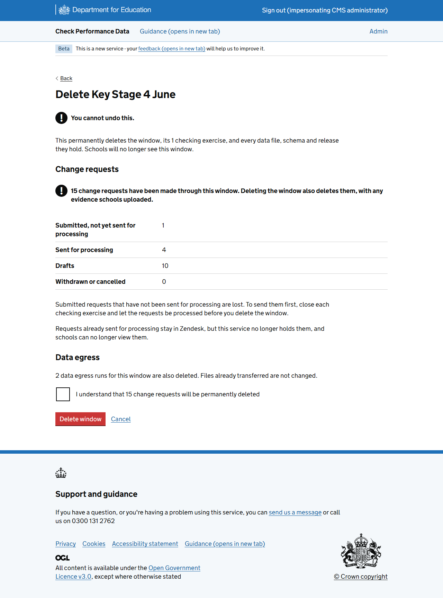
*The page for deleting a window.*

Both pages count the change requests by status: *Submitted, not yet sent for processing*, *Sent for processing*, *Drafts* and *Withdrawn or cancelled*. The requests are deleted with any evidence schools uploaded.

- Submitted requests that have not been sent for processing are lost. To send them first, close the exercise, or send its requests for processing, before you delete it.
- Requests already sent for processing stay in Zendesk. This service no longer holds them, and schools can no longer view them.

If you select the delete button without ticking the box, nothing is deleted. The page says *Confirm that you want to delete the change requests made through this window*, or *through this exercise*. The service counts the requests again when you select the button, so it asks if a school made a request while you had the page open.

Deleting a window also deletes its data egress runs. Files already transferred to LDS are not changed. Schools no longer see the window. The *Manage windows* screen then shows a *Success* banner, for example *Key Stage 4 June deleted.*

Each delete is recorded in the audit log.

### Requests for a window

Select **Requests** on a window in *Manage windows* to see every request made in that window. The page is read-only. Use it to check what schools have asked for, and what happened to each request. Select **Back to windows** to return.

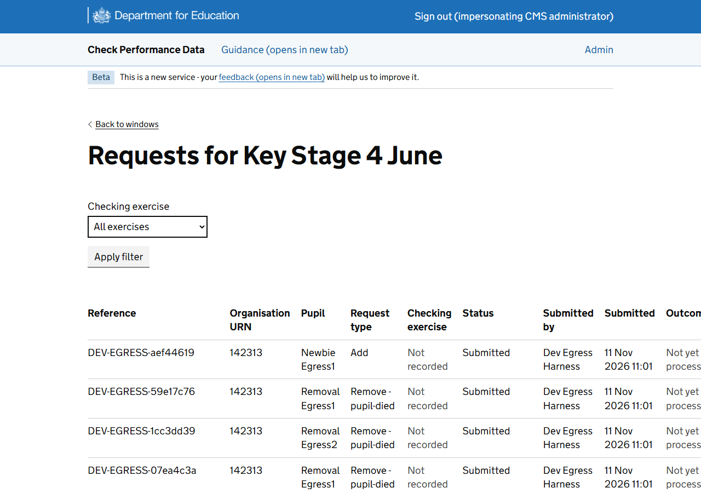
*The top of the Requests screen. The table continues below and is wider than the screen.*

To show one exercise only, choose it under **Checking exercise** and select **Apply filter**. Choose **All exercises** to show every request. Results enquiries appear here under the Results enquiry exercise.

The table has these columns, in this order:

| Column | What it shows |
|---|---|
| Reference | The request's reference. |
| Organisation URN | The school's URN. |
| Pupil | The pupil's name. |
| Request type | The type of change and the reason, such as *Remove - Dual registered or moved school*. |
| Checking exercise | The exercise the request was made in, or *Not recorded* if it has none. |
| Status | *InProgress*, *ReadyToSubmit*, *Submitted*, *Withdrawn* or *NotSubmitted*. |
| Submitted by | The name of the person who made the request. |
| Submitted | The date and time. |
| Outcome | *Auto approved*, *Auto rejected* or *Scrutiny*, or *Not yet processed*. |
| Matched Rule | The rule that decided the outcome. |
| Zendesk Id | The ticket number, once one exists. When the service knows the Zendesk address, the number is a link that opens the ticket in a new tab. |
| Processing | For a submitted request: where it is on its way to a ticket (*Decided*, *TicketQueued*, *TicketCreating* or *TicketCreated*), or *Waiting for decision*. A dash for any other request. |

For a request the rules engine has decided, select **Decision trace for** and the reference under the row to see how the engine reached its decision. The trace lists each condition the engine checked and whether it was true, ending with the rule that decided.

### Who can do what

Two sections control *Manage windows*, and you give them to a role separately:

- **new-window** lets a role see the **New window** button and finish the pages that create a window.
- **manage-window** lets a role use *Manage windows*, the window summary, the requests list, and every page for changing a window. That includes adding, editing and deleting exercises, choosing files, validating, retiring data files, making a release live, closing, sending requests, extensions, and deleting a window.

The create pages use pages from both sections. A role that has only one of them gets a *Page not found* screen part-way through. Give both sections together. Chapter 5 explains how to change what a role can see, under Role settings.

Retiring a data file and making an earlier release live can both be undone, so Appendix A does not list them.

## 8. Data egress

### What an egress run is

An egress run takes the decisions that caseworkers have made in Zendesk for one checking window, prepares them to the Learning Data Service (LDS) specification, checks the files, and sends them to LDS.

A run works with one or 2 **output types**:

- **New learners**: requests to add a pupil.
- **Remove learners**: requests to remove a pupil.

Only one run can be active for a checking window and an output type at any time. If a colleague already has one, the service tells you who and since when. Once an output type has been sent to LDS for a window, it cannot be sent again. A run that failed, or that someone abandoned, does not block a new one.

### Starting a run

Use *Start a new egress* to begin.

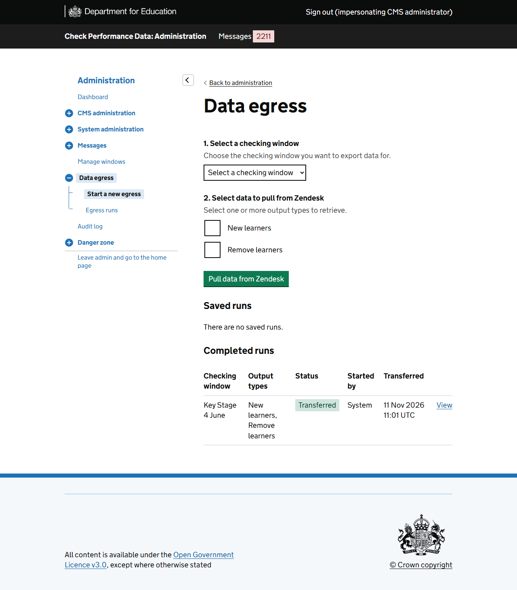
*The Data egress screen.*

1. Under **1. Select a checking window**, choose the window.
2. Under **2. Select data to pull from Zendesk**, tick **New learners**, **Remove learners** or both.
3. Select **Pull data from Zendesk**.

The service reads each decision, and the other values that go into the files, from the Zendesk ticket. A correction that a caseworker makes on a ticket therefore reaches the file. The service does not work those values out again from its own records. It reads its own records only for the few values that have no Zendesk field.

The service saves the run as soon as the pull finishes. The same screen lists *Saved runs* that are still in progress, each with a **Resume** button, and *Completed runs*, with a **View** link.

If the service refuses to start the run, it says why. There are 3 common reasons:

- *{Output type} for this checking window is already being processed by {name}, started {date} at {time} UTC. Wait for that run to finish or be abandoned.*
- *{Output type} for this checking window has already been transferred to LDS by {name} on {date} at {time} UTC. It cannot be sent again.*
- *Zendesk could not be read: …* This appears when the service cannot read the tickets. One cause is that the environment has no Zendesk ticket field id set for a field that egress reads. The message then names the fields, in the form *These Zendesk field ids are not configured for this environment (ZendeskTicketFields), so egress cannot read them: …* You cannot fix this from the admin area. Ask the development team to set the missing ids (Appendix D).

### Reviewing the pulled data, preprocessing and transferring

A run has 5 screens. You move through them in order.

**1. Data pulled from Zendesk.** The screen lists every request for the output types you chose, whatever its decision, with one tab for each output type. Each row shows the **Ticket ID**, **Reference**, **Decision**, **Reason**, **Key stage**, **DfE establishment number**, **Surname**, **Forename**, **Sex**, **Date of birth**, **Admission date**, **Year group**, **SEN status**, **UPN or ULN**, **CYPMD ID**, **LDS matched pupil ID**, **School URN** and **Submitted**. A column is blank when the record has no value for it. Only approved and auto-approved requests go forward.

The buttons are **Proceed to preprocessing**, **Save and exit** and **Abandon run**.

**2. Preprocessing data.** Select **Run preprocessing**. The service prepares the records in 8 steps and shows progress as it goes: Filter records, Read correction codes, Split DfE establishment number, Standardise dates, Build LDS records, Trim values, Validate against LDS spec and Save to database. Do not leave the page while it runs. If you do, the run goes back to the pulled data and nothing is saved. When it finishes, the service takes you to the next screen.

**3. Preprocessing failed.** You only see this screen if a record has a problem. The service says how many problems it found. One failing record fails the whole batch, so nothing is saved and nothing is sent. The *Records that failed* list shows the **Ticket ID**, **Reference**, **Step**, **Field** and **Problem** for each one. Correct the source data in Zendesk, then select **Start a new egress**. Select **View the pulled data** to look at the records again. You cannot retry a failed run. You always start a new one.

**4. Confirm transfer to LDS.** The screen shows the checking window, when the data was preprocessed and the target container. Under *Files to be transferred* it lists each file with its record count. Select **preview** beside a file name to look at it, and **Download** to save a copy. When you are sure, select **Confirm and transfer**.

**5. Transfer complete.** The screen shows what was sent: the files, the number of records in each, and a checksum for each. It also shows who transferred them, when, and the status *Success*. Select **Start a new egress** to begin another run.

If the transfer fails, the service removes any file it had already written. The run shows as failed. You can try the transfer again from the *Confirm transfer to LDS* screen.

The *Data pulled from Zendesk*, *Preprocessing data* and *Confirm transfer to LDS* screens all have **Save and exit** and **Abandon run**. **Save and exit** only leaves the page. You do not need to save, because the service saved the run when the pull finished. Select **Resume** on the *Data egress* screen to go back to where you were.

> **Warning** **Abandon run** does not ask you to confirm. It ends the run straight away. If the run was in the middle of a transfer, the service also removes any files it had already written to LDS storage. The run can never be resumed. You need to start a new one.

### Egress runs

Use *Egress runs* to see the history of every run.

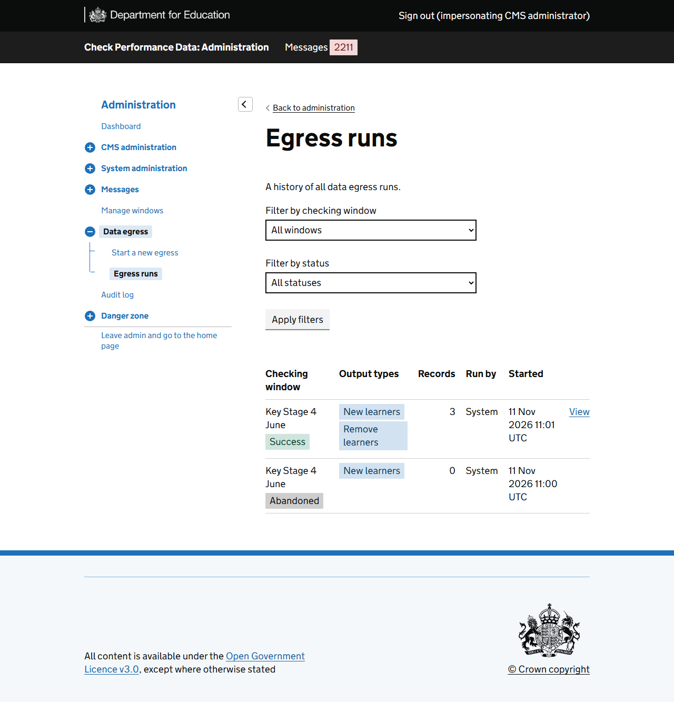
*The Egress runs screen.*

You can filter by **checking window** and by **status**, then select **Apply filters**. The statuses are:

- **Success**: the files were sent to LDS.
- **Failed**: preprocessing or the transfer failed.
- **Draft**: the run is still in progress.
- **Abandoned**: someone abandoned it.

Each row shows the checking window, the output types, the number of records, who ran it and when it started. The **Records** figure is what LDS received. It is 0 for any run that was not sent. Select **View** to open a finished run. For a run in progress, the link is **Resume**.

## 9. Audit log

Use the *Audit log* to see a record of administrative activity in the service, including every data egress run.

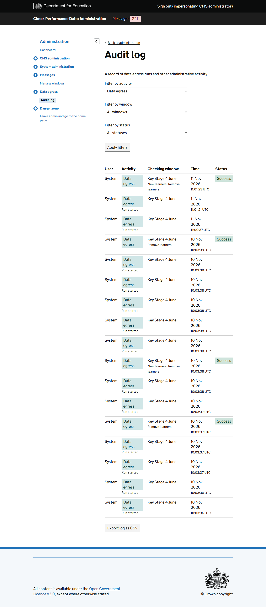
*The Audit log, filtered to Data egress.*

The list shows the newest entries first, 20 to a page. The columns are **User**, **Activity**, **Checking window**, **Time** and **Status**.

- For data egress, the Activity is a *Data egress* tag. A pull shows *Run started*. A transfer shows a *Success* or *Failed* status.
- When someone closes an exercise early, the Activity is a *Window admin* tag. The Checking window column names the window, with the exercise and *closed early, before scheduled end* beneath. The User column shows who closed it, and the Status is *Success*.
- When the service sends an exercise's requests for processing by itself, the Activity is also a *Window admin* tag. The Checking window column names the window, with the exercise and how many requests were sent and drafts cancelled beneath. The User column shows *System*, and the Status is *Success*.
- When someone adds, changes, closes early or sends the requests of an extension (extra time for named schools), the Activity is a *Window admin* tag. The Status is *Success*. The detail beneath the tag is one of these, with the exercise name first:
    - *{Exercise} extension added for 3 schools, ending 01/12/2026 17:00*
    - *{Exercise} extension edited: 1 school added, 0 schools removed, ending 01/12/2026 17:00*
    - *{Exercise} extension closed early, before its end*
    - *{Exercise} extension requests sent for processing: 4 requests sent, 2 drafts cancelled*
- When an administrator starts or ends viewing the service as an establishment (chapter 10), the Activity is an *Establishment impersonation* tag. Beneath it is *Start*, or *Exit*, then the establishment's LAESTAB and URN, as in *Start: LAESTAB {number}, URN {number}*. The Status is *Success*. When someone tries a change that is blocked during viewing, the detail starts *BlockedChange* and the Status is *Failed*.
- For everything else, the Activity is the type of item that changed, with the action beneath it: Insert, Update or Delete.
- Actions the service takes for itself show *System* as the user.

By default the log shows all activity. Most of it is routine application log entries, marked *App log*, which can hide the entries you want. To find something, use the filters:

- **Filter by activity**: choose the type of item, such as *Data egress*, *Dead letter* or *Role access*.
- **Filter by window**: choose a checking window.
- **Filter by status**: *Success* or *Failed*. Only two kinds of row can be *Failed*: a data egress transfer that failed, and a blocked change while viewing the service as an establishment. Every other row that has a status, such as an exercise closed early, an extension change, or requests the service sent by itself, is *Success*.

Select **Apply filters**. The filters work together.

Select **Export log as CSV** to download every entry that matches your filters. The file has one line for each entry, with these columns: *Timestamp (UTC)*, *User*, *Activity*, *Action*, *Entity type*, *Entity id*, *Checking window*, *Output types* and *Status*. It never includes the details of what changed.

You cannot edit or delete audit log entries from the service.

## 10. View as an establishment

Use *View as an establishment* to see the service as one school or college sees it. It is read-only. You can look at what the establishment sees, but you cannot save or submit anything. Use it to help a school that says it cannot see something, or to check what a school sees after a data release.

### Who can use it

Only the `cypmd_admin` role can use *View as an establishment*, and only when you are signed in through DfE Sign-In. It is not an admin section, so it does not appear on *Role settings* and an administrator cannot give it to another role. A sign-in made with the development tools (**As CMS Admin**) cannot use it.

If your role cannot use it, the service refuses you. The browser address changes to `/Account/AccessDenied`, and the *Page not found* screen appears.

### Starting

1. Select **View as an establishment** on the *Administration* page, or in the side menu.
2. Choose the establishment, as described below.
3. Select **Continue to choose where to start**.
4. On the next screen, choose where to start (see "Choosing where to start").

*The View as an establishment screen.*

The screen says: *View establishment data in read-only mode. You cannot save or submit changes.* You can fill it in 2 ways.

- **Search.** In **Search for an establishment**, enter at least 2 characters from the establishment's name or URN. Choose one of the suggestions, up to 25 of them. The service fills in the four fields below for you. If nothing matches, the box says *No establishments found*. The search needs JavaScript.
- **Type the details.** Enter the **LAESTAB** (7 digits), the **URN** (6 digits), the **Lowest age** and the **Highest age**. Without JavaScript this is the only way.

The screen refuses details it cannot use, and says why:

- *Enter a Laestab*, *Enter an Urn*, *Enter the lowest age* or *Enter the highest age* when a box is empty.
- *Enter a valid LAESTAB* or *Enter a valid URN* when the number does not have the right number of digits.
- *Enter an age between 0 and 150* when an age is outside that range.
- *The highest age must be greater than the lowest age*.

### Choosing where to start

The next screen is headed *Choose where to start impersonation*.

*Choosing where to start.*

It shows a summary of the establishment: its name, LAESTAB, URN and age range. You then have 2 choices:

- Select **Go to establishment home page** to start on the page a school sees when it signs in.
- Under *Checking exercises with establishment data*, find the window and the exercise, then select **View this checking window**. The service starts on that window's *Check your pupil data* page.

The list holds only the exercises where the service has imported data for this LAESTAB. For each exercise it shows a tag and a table called *Imported data by dataset*, with the **Rows read** and **Rows imported** for each file.

- **URN matched** (green) means the imported rows belong to the URN you entered.
- **URN could not be verified** or **URN does not match** (yellow) means the service cannot confirm the URN. The counts are then for the LAESTAB, and may include data for a different URN.

If no exercise holds data for the LAESTAB, the screen says *No checking exercise summaries show imported data for this LAESTAB.* You can still select **Go to establishment home page**. If the service could not read some summaries, a warning says *Some checking exercise summaries could not be checked. The list may be incomplete.*

If you chose the exercise and it has since become unavailable, the screen says *That exercise is no longer available for this establishment. Choose another destination.* Select **Choose a different establishment** to go back to the first screen.

### While you are viewing

Every page shows a banner at the top with the heading *Read-only impersonation*. It says which establishment you are viewing: *Viewing LAESTAB {number}, URN {number}. Changes cannot be saved or submitted.* The banner has an **Exit impersonation** button.

*The banner shown on every page while you view an establishment.*

You can open:

- the establishment's landing page
- *Check your pupil data*, and its downloads
- the lists of requests, and the pages for a draft or a submitted request
- the evidence files on a submitted request

On the request lists, the tick boxes, the buttons that submit requests, and the **Edit** and **Delete** links are not shown. Draft requests have a **View** link instead. On *Check your pupil data*, the buttons that start a request are not shown.

You cannot do anything that saves or submits. You also cannot open any admin page. If you try, the service shows a page headed *Read-only impersonation* that says *This action is unavailable while impersonating. Exit impersonation using the banner before accessing admin sections or making changes.* Select **Return to establishment data** to go back.

Some things change for you while you view:

- The **Admin** link is hidden from the navigation row.
- The pencil buttons that edit content blocks and page titles are hidden.
- The **Edit** button on CMS pages is still shown, but selecting it opens the refusal page.
- If you open a checking window that is not open for the establishment, the service shows *Establishment data unavailable*.

### Stopping

Select **Exit impersonation** in the banner. The service takes you back to the *Administration* page. Signing out also ends it.

### The audit log

The service records when you start and when you exit, with the LAESTAB and URN, in the audit log (chapter 9). It also records each time the service blocks a change while you are viewing. Those rows show the status *Failed*.

## 11. Danger zone

This group holds actions that permanently delete or change data. Use them with care.

### Reset seed data

Use *Reset seed data* to put a test environment back to its starting state.

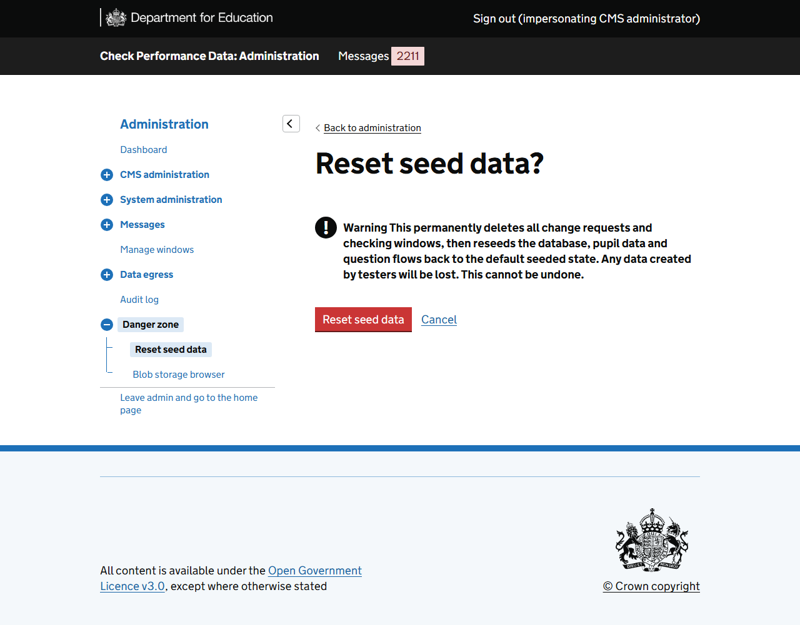
*The Reset seed data screen.*

The screen is available in every environment except production. Testers use it on development, QA and preproduction. Its heading is *Reset seed data?*

A reset puts these things back to their starting state:

- **The checking windows.** The service deletes every window and creates seven: *Key Stage 4 June*, *Key Stage 4 Autumn*, *Key Stage 2*, and four Post 16 windows, *16 to 19 Oct*, *16 to 19 Nov*, *16 to 19 Feb* and *16 to 19 Mar*. Each one has its checking exercises and data files set up. The four Post 16 windows are one for each step of the results enquiry year.
- **The sample data files.** The service loads sample pupil, results and summary files into each window and validates them, so each window has a release. It also copies the sample files into Ingress Storage, so you can repeat a step by hand.
- **The sample change requests**, the pupil data and the question flows.
- **The rules and the country languages.** The service puts the rules back only if the rules it ships are newer than the saved ones, or the saved ones are unusable. It leaves the country languages alone if they exist. The qualification list is put back if it is missing.

> **Warning** This permanently deletes all change requests and checking windows. It then puts the database, pupil data and question flows back to the default seeded state. Any data testers created is lost. This cannot be undone. The screen is the only confirmation. When you select **Reset seed data**, it happens straight away. Select **Cancel** to leave.

### Blob storage browser

Use the *Blob storage browser* to look at files in the service's storage, and to upload, download and delete them.

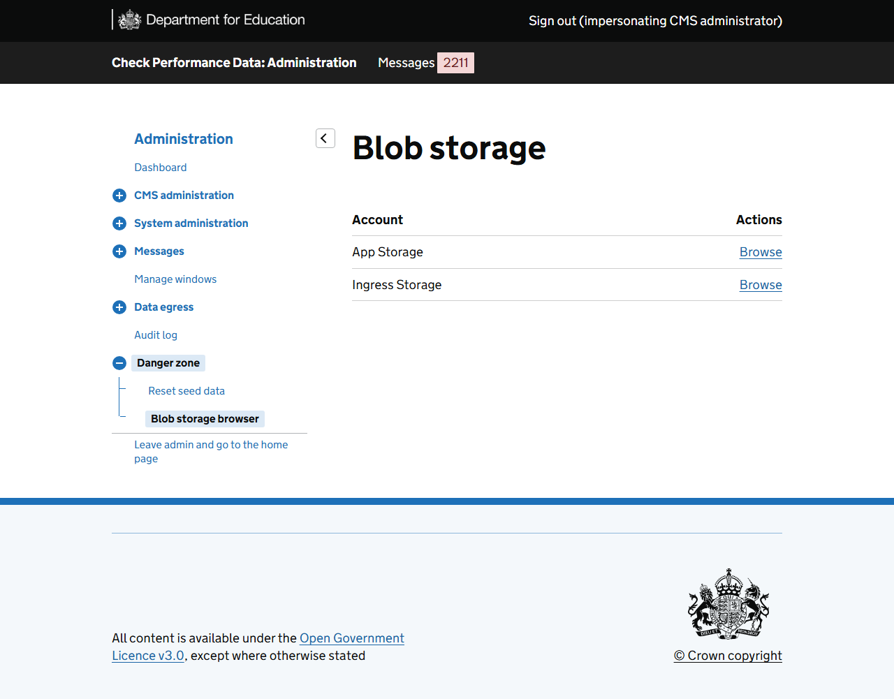
*The Blob storage screen.*

There are 2 storage accounts:

- **App Storage**: the service's own files. It holds one container for each checking window, with the pupil data for that window.
- **Ingress Storage**: the files that suppliers send in, which you choose from when you set up a window. The files that data egress prepares for LDS are also here, in the container `cypmd`, in the folder `extracts_input/`.

To find a file:

1. Select **Browse** beside an account.
2. Select **Browse** beside a container. The screen says how many containers the account holds.
3. Select **Open** on a folder to go into it. Select **Up to container root** to come back out. Files show **Preview**, **Download** and **Delete** buttons. The preview screen also has a **Download this blob** link. For a large text file, the preview shows only the first 256KB and says so; download the file to see all of it.

To upload files, use the *Upload files* section at the top of a container. Choose one or more files. To put them in a new sub-folder, type its name in **Folder (optional)**. Leave it blank to upload into the folder you are looking at. Then select **Upload**.

With JavaScript on, each file can be up to 2GB. The service sends it in parts and shows progress under the form; you can select **Cancel upload** to stop. When the upload finishes, the page opens the folder the files went into. Without JavaScript, the files you choose must add up to less than 50MB, because the platform refuses larger requests before they reach the service. If an upload does not complete, the page tells you what to do.

Storage can hold pupil data. Only open, download or preview files that you need to. Look after any file you download.

> **Warning** Select **Delete** on a file to delete it from storage. The only check is a message from your browser that asks *Delete {file name}?* Once you confirm, the file is gone and cannot be recovered. Do not delete the files a window or an egress run depends on.

## Appendix A: Actions that cannot be undone

This table lists the actions in the admin area that change or delete data. It says whether the service asks you to confirm first.

| Screen | Action | What it does | Does it ask you to confirm? |
|---|---|---|---|
| Window summary | Close an exercise early | Ends the exercise for schools straight away, sends submitted requests for processing and cancels drafts. Schools in an open extension keep their extra time. Cannot be undone. | Yes. You must type the window's name. |
| Window summary | Send requests for processing | For an exercise that has closed: sends submitted requests for processing and cancels drafts. Cannot be undone. | Yes. A confirmation page shows the counts. |
| Window summary | Close an extension early | Ends the extra time for the extension's schools straight away. Does not send their requests. Cannot be undone. | Yes. You must type the window's name. |
| Window summary | Send an extension's requests for processing | For an extension that has ended: sends its schools' submitted requests for processing and cancels their drafts. Cannot be undone. | Yes. A confirmation page shows the counts. |
| Window summary | Delete (a checking exercise) | Deletes the exercise, its data files, releases, extensions and uploaded files, and every change request made through it. Cannot be undone. | Yes. A confirmation page lists what goes. If there are change requests, you must tick a box. |
| Window summary | Delete window | Deletes the window, its checking exercises and their files, every change request made through it with any evidence, and its data egress runs. Files already transferred to LDS are not changed. Cannot be undone. | Yes. A confirmation page lists what goes. If there are change requests, you must tick a box. |
| Data egress | Confirm and transfer | Sends the files to LDS. The same output type cannot be sent again for that window. | No. The screen warns you that this cannot be undone. |
| Data egress | Abandon run | Ends the run for good. Removes any files a transfer had already written. | No. |
| Dead-letter queue | Purge | Deletes a message for good. The audit log keeps a record of the purge. | Yes. A dialog asks *Purge this message?* |
| Dead-letter queue | Redrive | Sends a message back to its queue. May create a ticket. | Yes. A dialog asks *Requeue this message?* |
| View logs | Clear all logs | Deletes every log entry. | Yes. A dialog asks *Clear all application logs?* |
| Search analytics | Delete this session's data | Deletes every search event and message from one session. | Yes. A dialog asks *Delete this session's data?* |
| Share links | Revoke | Switches a share link off for good. | No. |
| Rules Engine configuration | Delete an outcome | Removes an outcome and its branches. Can be rolled back. | Yes. You type the outcome key. |
| Rules Engine configuration | Remove a branch | Removes one branch. Can be rolled back. | Yes. A confirmation page. |
| Rules Engine configuration | Remove a country | Removes a country from the language list. Can be rolled back. | No. |
| Rules Engine configuration | Roll back | Saves an earlier version as a new version. | Yes. A confirmation page. |
| Pages | Delete a page | Moves the page to Deleted pages, where it can be restored. The screen says it cannot be undone. | Yes. A confirmation page. |
| Content blocks | Revert to an earlier version | Replaces the published content with an earlier version. | Yes. A dialog. |
| Content staging import/export | Import with Overwrite | Replaces content that already exists. | Yes. The *Review import* screen. |
| Content staging import/export | Clear all CMS content | Deletes every page, content block and home page banner. Development environments only. | Yes. A dialog asks *Clear all CMS content?* |
| Blob storage browser | Delete a file | Deletes the file from storage. | Only a browser message. |
| Danger zone | Reset seed data | Deletes all change requests and windows, then reseeds. Not in production. | The Reset seed data screen is the only confirmation. |

## Appendix B: Admin sections a role can be granted

*Role settings* lists 32 sections. This table shows what each one unlocks, grouped in the order of the Administration page.

| Group | Section | What it unlocks |
|---|---|---|
| Dashboard | `dashboard` | Dashboard |
| CMS administration | `content-pages` | Pages |
| CMS administration | `content-blocks` | Content blocks |
| CMS administration | `home-banners` | Home page banners |
| CMS administration | `deleted-pages` | Deleted pages |
| CMS administration | `content-staging` | Content staging import/export |
| CMS administration | `search-analytics` | Search analytics and its drill-down screens |
| System administration | `observability` | Pipeline dashboard |
| System administration | `transactions` | Transactions |
| System administration | `replay-submissions` | Replay |
| System administration | `share-admin` | Share links, which has no menu entry |
| System administration | `rules-engine` | Queues |
| System administration | `rules-engine-queue` | Rules Engine Queue |
| System administration | `zendesk-queue` | Zendesk Queue |
| System administration | `rules-config` | Rules Engine configuration |
| System administration | `system-settings` | System settings |
| System administration | `app-logs` | View logs |
| System administration | `site-assets` | Site CSS and JavaScript (administrators only) |
| System administration | `role-settings` | Role settings |
| System administration | `test-data-group` | The Test data heading |
| System administration | `seed-sample-pages` | Seed sample CMS pages |
| System administration | `seed-sample-search-data` | Seed sample search data |
| Messages | `messages-inbox` | Search feedback |
| Messages | `dead-letter-queue` | Dead Letter Queue |
| Manage windows | `window-admin` | Nothing now. The section is still on *Role settings*, but no screen uses it. |
| Manage windows | `new-window` | The **New window** button, and the last 2 steps of creating a window: *Check your answers* and cancelling |
| Manage windows | `manage-window` | The *Manage windows* list, the window summary, the requests list, the first 3 steps of creating a window (title, window type and dates), and every page for changing or deleting a window or an exercise |

A role needs both `new-window` and `manage-window` to create a window. Chapter 7 explains this under "Who can do what".

*View as an establishment* (chapter 10) is not in this table. It is not a section, so it cannot be given to a role. Only the `cypmd_admin` role can use it.
| Data egress | `egress` | Start a new egress and every screen of a run |
| Data egress | `egress-runs` | Egress runs |
| Audit log | `audit-log` | Audit log |
| Danger zone | `reset-seed-data` | Reset seed data |
| Danger zone | `storage-browser` | Blob storage browser |

## Appendix C: System settings reference

This appendix explains every setting on the *System settings* screen. The setting names are the ones the screen shows. Chapter 5 explains how to change them.

### CMS

| Setting | What it does | Default |
|---|---|---|
| `CMS:PageLength` | The number of rows shown on each page of a list. | 20 |
| `CMS:SearchDebugOn` | When on, the service records why each page did or did not appear in a search, for people fixing search problems. | Off |
| `CMS:ShowDeleteAllButton` | When on, the Content staging screen offers the Clear all CMS content button. It never appears in production, QA or preproduction, whatever this says. | Off |

### Dead-letter queue

| Setting | What it does | Default |
|---|---|---|
| `Dlq:AlertRecipients` | The email addresses to tell when the dead-letter queue is too long. Separate addresses with commas. | Empty |
| `Dlq:AlertThreshold` | The number of messages in the dead-letter queue at which the service sends an email alert. | 10 |
| `Dlq:FullPayloadEnabled` | When on, administrators can see the full contents of a dead-lettered message, including pupil details. Every view is recorded in the audit log. | Off |
| `Dlq:RetentionDays` | How many days a dead-lettered message is kept before it is deleted. The audit log entries are kept separately. | 90 |

### Pipeline health thresholds

These settings decide when the health strip on the Pipeline dashboard changes colour.

| Setting | What it does | Default |
|---|---|---|
| `Health:DepthAmber` | The number of messages waiting in a queue at which the strip turns amber. | 25 |
| `Health:DepthRed` | The number of messages waiting in a queue at which the strip turns red. | 100 |
| `Health:DlqRateRed` | The number of messages in the dead-letter queue at which the strip turns red. | 5 |
| `Health:OldestAgeAmberSeconds` | How old, in seconds, the oldest waiting message must be for the strip to turn amber. | 120 |
| `Health:OldestAgeRedSeconds` | How old, in seconds, the oldest waiting message must be for the strip to turn red. | 600 |

### Queue metrics

| Setting | What it does | Default |
|---|---|---|
| `Metrics:RetentionDays` | How many days the service keeps the queue figures behind the Pipeline dashboard charts. | 30 |
| `Metrics:RetentionIntervalMinutes` | How often, in minutes, the service deletes old queue figures. | 60 |

### Notifications

| Setting | What it does | Default |
|---|---|---|
| `Notify:UseFake` | When on, the service does not send real emails. It writes them to a log instead. Turn this off in an environment where emails need to go out, such as the dead-letter queue alerts. | On |

### Search analytics

| Setting | What it does | Default |
|---|---|---|
| `SearchAnalytics:MessageRetentionDays` | How many days a feedback message is kept. The most it can be set to is 730. | 365 |
| `SearchAnalytics:RetentionDays` | How many days search events are kept. The most it can be set to is 365. | 90 |
| `SearchAnalytics:RetentionIntervalMinutes` | How often, in minutes, the service deletes old search data. | 60 |
| `SearchAnalytics:SeedSecondsPerEvent` | An estimate, in seconds, of how long each event takes when seeding sample search data. The service adjusts it as it learns. You should not need to change it. | 0.1 |
| `SearchAnalytics:SessionAbsoluteHours` | The longest a search session can last, however active the person is. The most it can be set to is 168, which is one week. | 24 |
| `SearchAnalytics:ShowSessionComment` | When on, every page includes a hidden comment with the session ID, so that support staff can trace a problem. Only turn this off where visible session IDs are not acceptable. | On |

## Appendix D: Getting help

If something in the admin area does not work as this guide describes, or you need an access change that you cannot make yourself, contact the development team through the service's usual support route.

The source of this guide is the file `docs/user-guides/admin-user-guide.md` in the `DFE-Digital/check-performance-data` repository. It is kept up to date with the service. Anyone who can change the repository can suggest a correction.
